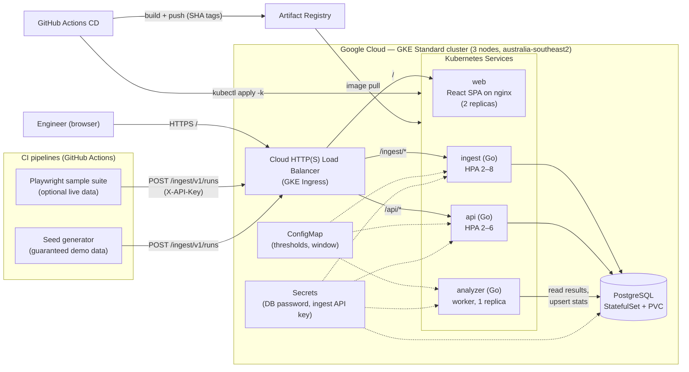
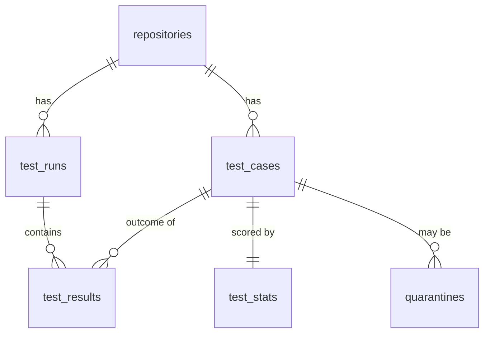

My plan I created with claude:
# FlakeTracker — Project Plan (Claude Code Handoff)

> **Working name:** FlakeTracker (rename freely).
> **What it is:** a cloud-native web application that ingests automated test results from CI pipelines, detects **flaky tests** (tests that pass and fail without code changes), and gives engineers a dashboard to triage and quarantine them.
> **Why this doc exists:** it is the single source of truth for building this project. It captures the university assessment requirements, every decision already made, the architecture, and a phased build plan with acceptance criteria. Read it fully before writing code.

---

## 0. How to use this document (instructions for Claude Code)

1. Work through the **phases in Section 14 in order**. Each phase has a Definition of Done — verify it before moving on.
2. After each phase: run the phase's checks, commit with a clear message, and tick the checkbox in this file.
3. **Ask the owner before** running any command that creates, modifies or deletes GCP resources (clusters, load balancers, disks, registries, IAM). These cost real credit. Local work (Docker, Compose, tests) needs no approval.
4. **Every shell command you write into a script, README or demo file must have a comment explaining what it does and what its parameters mean.** This is an explicit marking requirement (Section 2.4). No uncommented commands anywhere in the repo.
5. The owner must present and defend this code live in a 2-minute Q&A. **Prefer simple, readable, idiomatic code over clever abstractions.** Use the standard library where reasonable. Explain non-obvious patterns in code comments.
6. Never commit secrets. Use `.env.example` files and Kubernetes Secrets created by a commented script.
7. Never use the `latest` image tag in Kubernetes. Tag images with the git commit SHA (enables rollout history and rollback).
8. Do not add major technologies beyond Section 6 without asking. Stretch items (Section 13) come last.

---

## 1. Owner & environment context

| Item | Value |
|---|---|
| Course | INFS3208 Cloud Computing, University of Queensland, Semester 2 2026 |
| Assessment | Individual Project, **Type I — Highly scalable and available web application** |
| GCP project ID | `infs3200-project` (the name contains a typo from creation; it is the correct ID — do not "fix" it) |
| Preferred region/zone | `australia-southeast2` (Melbourne), zone `australia-southeast2-b` used previously |
| Prior experience | Docker, Docker Compose, GKE, StatefulSets + `volumeClaimTemplates`, headless Services, ConfigMaps, Secrets, PVCs, `fsGroup`, LoadBalancer Services, Cloud Shell + `kubectl` |
| Languages | TypeScript (frontend + small tooling scripts), Go (all backend services) |
| GCP credit | Limited — cost hygiene matters (Section 12) |

---

## 2. Assessment specification (summarised from the official task sheet and rubric)

### 2.1 Overview
- Worth **20 marks**: **Proposal (5)** + **Implementation (15)**.
- **Due: 3:00 PM Wednesday 21 October 2026** (Week 12) on Blackboard — proposal **and** source code in the same deadline.
- Implementation is **marked in person** by a tutor in **Week 13** via a live presentation/demo.

### 2.2 Proposal requirements (5 marks)
- **Max 1,000 words, max two A4 pages**, submitted as PDF or DOCX.
- Required sections and marks:

| Section | Sub-item | Marks |
|---|---|---|
| Introduction (2.5) | Background: what is the project about? | 0.5 |
| | Motivation: why is it important? | 0.5 |
| | Overall objective and features | 0.5 |
| | Limitations of traditional (non-cloud) computing solutions | 0.5 |
| | Benefits of cloud computing for this project | 0.5 |
| Technical Solutions (1.5) | Cloud technologies used (frontend and backend) | 1.0 |
| | **Monthly cost estimate** of all cloud resources (must be reasonable; use GCP Pricing Calculator) | 0.5 |
| Architecture Design (1) | Figure depicting the workflow/framework (e.g., microservice diagram) | 1.0 |

### 2.3 Type I technical requirements (from the task sheet)
- **Frontend:** functional UI that lets users interact with the app, with **at least 4 different functionalities**.
- **Backend:** e.g., a database working together with the frontend.
- **Containerisation:** Docker, **multiple containers in a microservice architecture**.
- **Orchestration:** Docker Swarm **or Kubernetes** orchestrating multiple containers **across hosts** (→ the cluster must have **≥2 nodes**; we use 3).
- Must be scalable, reliable and resilient; must support **rolling updates and rollback**.

### 2.4 Presentation rules (from the marking notes)
- **Strictly 4 minutes.** Overrunning loses marks. **2 minutes Q&A.**
- **Marks deducted for technical disruptions during the demo, e.g. scaling failures.** → The demo must be rehearsed and have fallbacks.
- **Each submitted command must have clear comments explaining its function and parameters.**
- **The application must be fully deployed to the cloud.** Local-only demos lose marks.
- Presentation should cover: background & motivation; architecture & technologies; **database design** (Type I); results & discussion.

### 2.5 Submission contents
- Proposal PDF/DOCX (≤1,000 words, 2 pages).
- One compressed file containing: **source code, README with deployment instructions, relevant data** (or an external link if data is too large).
- Filename: the spec does not state a convention; follow the course's previous convention to be safe: `FirstName_LastName_StudentNo.zip`.
- Back up code at least weekly (the GitHub repo satisfies this).

### 2.6 Implementation rubric — Type I (15 marks)

| Rubric item | Marks | How FlakeTracker satisfies it | Demo evidence |
|---|---|---|---|
| Frontend: interactive UI | 1 | React + TypeScript SPA with dashboard, leaderboard, test detail charts, quarantine management, run explorer | Live UI tour |
| Backend: database design and usage | 1 | PostgreSQL with 6 normalised tables, constraints and indexes (Section 8) | ERD slide + live data |
| ≥4 frontend/backend functionalities | 1 | 5 functionalities (Section 5) | UI tour |
| Microservice architecture + containerisation | 2 | 4 app services (`web`, `ingest`, `api`, `analyzer`) + Postgres, each in its own container, split by workload profile | Architecture slide, `kubectl get pods` |
| Scalability | 1 | HorizontalPodAutoscaler on `ingest` and `api`; k6 load test triggers scale-out | `kubectl get hpa -w` during k6 |
| Reliability | 1 | ≥2 replicas per stateless service, spread across nodes, PodDisruptionBudgets, readiness probes, idempotent ingest | Delete a pod / drain a node during load; k6 error rate stays ~0 |
| Load balancing | 1 | GKE Ingress → Google Cloud HTTP(S) Load Balancer with path routing; Services balance across replicas | Show Ingress + requests spread across pods |
| Orchestration (Swarm or K8s) | 3 | GKE Standard, 3 nodes; Deployments, StatefulSet, Services, Ingress, ConfigMap, Secret, HPA, PDB, Job | Manifests + live cluster |
| Rollout and rollback | 1 | RollingUpdate (maxUnavailable 0), SHA-tagged images, change-cause annotations, deliberate bad release → `kubectl rollout undo` | Live rollout + rollback |
| Originality, innovation, difficulty, completeness | 3 | Real-world DevOps problem; polyglot services; CI/CD with GitHub Actions; live Playwright data source; flakiness scoring algorithm | Whole demo |

> **Rubric ambiguity to resolve:** the extracted rubric lists two items — *"Data size and complexity: ≥10,000 records, multiple data files or tables" (1)* and *"Data storage" (1)* — directly after the Type I block. The Type I items above already sum to exactly 15, so these most likely belong to Type II. **Cheap insurance:** the seed generator (Section 11) produces **>10,000 records across multiple tables** anyway. The owner should confirm with a tutor on Ed Discussion.

---

## 3. Product concept

### 3.1 Problem
A **flaky test** is an automated test that sometimes passes and sometimes fails **on the same code**. Flaky tests:
- waste CI time (re-runs), block merges, and erode trust in the test suite ("just re-run it");
- hide real bugs, because genuine failures get dismissed as "probably flaky";
- are hard to spot by eye because each failure looks like a one-off.

Google's Testing Blog (2016, "Flaky Tests at Google and How We Mitigate Them") reported that about 1.5% of test runs produced a flaky result and almost 16% of tests showed some flakiness. *(Verify and cite properly in the proposal.)*

### 3.2 Solution
FlakeTracker collects every test result from every CI run, keeps the history, and computes a **flakiness score** per test. Engineers see a ranked leaderboard of the flakiest tests, drill into each test's pass/fail timeline, and **quarantine** tests so they stop blocking pipelines while being fixed.

### 3.3 Why cloud (proposal talking points)
- **Bursty write traffic:** results arrive in spikes when many pipelines finish together (e.g., a large merge wave). Autoscaling absorbs bursts; a fixed on-prem server must be sized for peak and sits idle otherwise.
- **High availability:** CI pipelines post results unattended; a single server outage loses data. Replicated pods across nodes + load balancing keep ingestion up.
- **Independent scaling:** the write path (ingest), read path (dashboard API) and batch computation (analyzer) have different load profiles, so each scales separately.
- **Pay-as-you-go + scale to zero** when idle; managed Kubernetes removes control-plane operations.
- **Zero-downtime updates:** rolling deployments and instant rollback for a tool that must always be available to CI.

### 3.4 Traditional limitations (proposal talking points)
- Spreadsheets / manual triage don't scale and have no history.
- A single VM running a monolith is a single point of failure, cannot scale parts independently, and updates require downtime.
- Buying hardware for peak load is wasteful; capacity changes are slow.

---

## 4. Decisions log

### 4.1 Locked decisions
| # | Decision | Reason |
|---|---|---|
| D1 | Type I project | Best fit for platform / cloud / DevOps career goals |
| D2 | Backend in **Go**, frontend in **TypeScript + React** | Two languages only (simplified from earlier 3-surface idea); Go suits bursty concurrent HTTP |
| D3 | **Kubernetes on GKE Standard**, 3 nodes, zonal | Rubric orchestration (3 marks) + "across hosts" requirement; prior GKE experience |
| D4 | **PostgreSQL** as a StatefulSet with a PVC | Relational data fits; reuses StatefulSet/PVC knowledge from Assignment 2; cheaper than Cloud SQL |
| D5 | 4 application services: `web`, `ingest`, `api`, `analyzer` | Split by workload profile (static / bursty write / read / batch compute) |
| D6 | **Playwright sample suite is optional, not load-bearing** | Live CI → webhook chain is the biggest demo risk and earns no extra marks; never run it live during the demo |
| D7 | **Seed generator** provides guaranteed demo data | Removes dependence on live CI; also covers the ≥10k-records ambiguity |
| D8 | **GitHub Actions** for CI (tests/build) and CD (build → push → deploy) | Industry-standard; strong originality/resume value |
| D9 | GKE's **built-in Ingress** (Google Cloud HTTP(S) Load Balancer) | No extra controller to install; provisions a real cloud load balancer |
| D10 | Ingest uses an **API key** (Secret); dashboard has **no user login** | Keeps scope tight; login is future work |
| D11 | One **canonical JSON ingest format**; adapters convert tool output into it | Keeps Go ingest simple; Playwright adapter written in TS |

### 4.2 Non-goals (explicitly out of scope unless everything else is done)
- User accounts / login / multi-tenancy.
- Highly available Postgres (single primary is accepted; mention Cloud SQL HA as future work in Q&A).
- Service mesh, JUnit XML ingestion (stretch), Slack/email alerts (stretch).

---

## 5. Functional requirements (the ≥4 functionalities)

| # | Functionality | User story | Services involved |
|---|---|---|---|
| F1 | **Overview dashboard** | As an engineer, I see totals (tests tracked, flaky count, broken count, quarantined count, runs ingested) and a chart of flaky-test count over time. | `web` → `api` |
| F2 | **Flaky test leaderboard** | I see tests ranked by flakiness score, filter by repository/branch/classification, search by name, and paginate. | `web` → `api` |
| F3 | **Test detail & history** | I open a test and see its score breakdown, a pass/fail timeline of recent runs, a duration trend chart, and links to the CI runs. | `web` → `api` |
| F4 | **Quarantine management** | I quarantine a test with a reason (and un-quarantine it later). CI can fetch the quarantine list to skip those tests. | `web` → `api` → DB; CI → `api` |
| F5 | **Run explorer** | I browse ingested CI runs (repo, branch, commit, time, pass/fail counts) and drill into a run's results. | `web` → `api` |
| F0 | **Result ingestion** (machine-facing) | CI posts results after each run; they appear in the dashboard after the next analysis cycle. | CI → `ingest` → DB → `analyzer` |

F1–F5 are the user-facing functionalities shown in the demo; F0 is the backbone.

---

## 6. Technology inventory

| Technology | Used for | Core / Stretch |
|---|---|---|
| **Go** (latest stable) | `ingest`, `api`, `analyzer`, `seed`, `migrate` binaries | Core |
| `net/http` (Go 1.22+ method-aware routing) | HTTP servers — no web framework needed | Core |
| `github.com/jackc/pgx/v5` (+ `pgxpool`) | Postgres driver and connection pool | Core |
| `github.com/golang-migrate/migrate/v4` | SQL schema migrations (run as a Kubernetes Job) | Core |
| `log/slog` | Structured JSON logging | Core |
| **TypeScript + React + Vite** | `web` single-page app | Core |
| React Router, TanStack Query, Recharts | Routing, data fetching/caching, charts | Core |
| **nginx** (unprivileged image) | Serves the built SPA inside the `web` container | Core |
| **PostgreSQL** (pin a major version, e.g. 17) | Primary datastore | Core |
| **Docker** (multi-stage builds, distroless runtime for Go) | Containerisation; small images = fast pulls on GKE | Core |
| **Docker Compose** | Local development and testing before cloud | Core |
| **Kubernetes on GKE Standard** | Orchestration | Core |
| **GKE Ingress** + `BackendConfig` | HTTP(S) load balancer with explicit health checks | Core |
| **HorizontalPodAutoscaler** (metrics-server is built into GKE) | Autoscaling | Core |
| **Artifact Registry** | Container image registry | Core |
| **GitHub Actions** | CI (lint/test/build) + CD (build/push/deploy) | Core |
| **Workload Identity Federation** (`google-github-actions/auth`) | Keyless GitHub → GCP authentication (no JSON keys) | Core (fallback: service-account key stored as a GitHub secret, if WIF blocks progress) |
| **Kustomize** (`kubectl apply -k`) | Image-tag substitution in CD | Core |
| **k6** | Load testing for the scalability/reliability demo | Core |
| **Playwright** | Sample test suite with deliberately flaky tests → realistic live data | Optional (D6) |
| **Terraform** | Provision GKE cluster, node pool, Artifact Registry, WIF as code | Stretch |
| **Cloud Monitoring / Managed Prometheus** | Live dashboards of request rate & pod count | Stretch |

---

## 7. Architecture

### 7.1 Services

| Service | Language | Kind | Replicas | Exposed via | Responsibility |
|---|---|---|---|---|---|
| `web` | TS/React → static files on nginx | Deployment | 2 | Ingress `/` | Dashboard UI |
| `ingest` | Go | Deployment + HPA (2–8) | 2+ | Ingress `/ingest/` | Validate + store CI results (write path, bursty) |
| `api` | Go | Deployment + HPA (2–6) | 2+ | Ingress `/api/` | Read API for the UI; quarantine writes |
| `analyzer` | Go | Deployment | 1 | Internal only (no Service needed except metrics) | Periodically recompute flakiness stats (batch compute) |
| `postgres` | — | StatefulSet + headless Service + PVC | 1 | ClusterIP/headless only | Persistence |
| `migrate` | Go / golang-migrate | Job | run-to-completion | — | Apply schema migrations before app rollout |

**Why this split (say this in the demo):** each service has a different load profile. `ingest` gets bursty writes when pipelines finish; `api` gets read traffic from humans; `analyzer` is CPU-bound batch work that must not slow down requests; `web` is static. Splitting lets each scale, fail and deploy independently (CQRS-style write/read separation).

**Analyzer safety:** it runs with `replicas: 1`, and its writes are **idempotent upserts**, so an accidental second replica or a restart mid-cycle cannot corrupt data.

### 7.2 Diagram (render for the proposal; export to PNG)



### 7.3 Request flows
1. **Ingest:** CI → LB → `ingest` → validate payload → single DB transaction (upsert repo/test cases, insert run + results, `ON CONFLICT DO NOTHING` for duplicates) → `202 Accepted` (or `200` if the run was already ingested).
2. **Analysis:** every `ANALYZER_INTERVAL` (default 60 s), `analyzer` finds test cases with new results since the last cycle, recomputes their stats, upserts `test_stats`.
3. **Read:** browser → LB → `web` (static assets) → the SPA calls `/api/v1/...` → `api` queries Postgres (mostly `test_stats` for fast leaderboard reads).

---

## 8. Data model (PostgreSQL)

### 8.1 Tables

```sql
-- A repository whose CI sends results.
CREATE TABLE repositories (
  id           BIGSERIAL PRIMARY KEY,
  full_name    TEXT NOT NULL UNIQUE,            -- e.g. "shivam/flaky-demo"
  created_at   TIMESTAMPTZ NOT NULL DEFAULT now()
);

-- A logical test, identified by repo + file/suite + title.
CREATE TABLE test_cases (
  id            BIGSERIAL PRIMARY KEY,
  repository_id BIGINT NOT NULL REFERENCES repositories(id) ON DELETE CASCADE,
  suite         TEXT NOT NULL,                  -- e.g. "tests/checkout.spec.ts"
  name          TEXT NOT NULL,                  -- e.g. "adds item to cart"
  first_seen_at TIMESTAMPTZ NOT NULL DEFAULT now(),
  UNIQUE (repository_id, suite, name)
);

-- One CI pipeline execution.
CREATE TABLE test_runs (
  id             BIGSERIAL PRIMARY KEY,
  repository_id  BIGINT NOT NULL REFERENCES repositories(id) ON DELETE CASCADE,
  ci_run_id      TEXT NOT NULL,                 -- e.g. GITHUB_RUN_ID
  ci_run_attempt INT  NOT NULL DEFAULT 1,       -- e.g. GITHUB_RUN_ATTEMPT
  branch         TEXT NOT NULL,
  commit_sha     TEXT NOT NULL,
  run_url        TEXT,
  started_at     TIMESTAMPTZ NOT NULL,
  ingested_at    TIMESTAMPTZ NOT NULL DEFAULT now(),
  UNIQUE (repository_id, ci_run_id, ci_run_attempt)   -- idempotency key
);

-- Final outcome of one test in one run (one row per test per run).
CREATE TABLE test_results (
  id             BIGSERIAL PRIMARY KEY,
  run_id         BIGINT NOT NULL REFERENCES test_runs(id) ON DELETE CASCADE,
  test_case_id   BIGINT NOT NULL REFERENCES test_cases(id) ON DELETE CASCADE,
  final_status   TEXT NOT NULL CHECK (final_status IN ('passed','failed','skipped')),
  attempts       INT  NOT NULL DEFAULT 1,       -- total attempts incl. retries
  passed_on_retry BOOLEAN NOT NULL DEFAULT false, -- failed first, passed later in same run
  duration_ms    INT  NOT NULL,                 -- duration of final attempt
  error_message  TEXT,                          -- first failure message, truncated to 2 KB
  UNIQUE (run_id, test_case_id)
);
CREATE INDEX idx_results_test_case ON test_results (test_case_id, run_id DESC);

-- Precomputed stats, written only by analyzer, read by api.
CREATE TABLE test_stats (
  test_case_id        BIGINT PRIMARY KEY REFERENCES test_cases(id) ON DELETE CASCADE,
  window_size         INT NOT NULL,
  sample_size         INT NOT NULL,
  pass_count          INT NOT NULL,
  fail_count          INT NOT NULL,
  flip_rate           DOUBLE PRECISION NOT NULL,
  retry_pass_rate     DOUBLE PRECISION NOT NULL,
  commit_conflict_rate DOUBLE PRECISION NOT NULL,
  flakiness_score     DOUBLE PRECISION NOT NULL,   -- 0.0 – 1.0
  classification      TEXT NOT NULL CHECK (classification IN ('stable','flaky','broken','insufficient_data')),
  algorithm_version   TEXT NOT NULL,               -- e.g. "v1", "v2" (visible in rollout demo)
  last_result_at      TIMESTAMPTZ,
  computed_at         TIMESTAMPTZ NOT NULL DEFAULT now()
);
CREATE INDEX idx_stats_score ON test_stats (classification, flakiness_score DESC);

-- Quarantine records (history kept; one active per test).
CREATE TABLE quarantines (
  id            BIGSERIAL PRIMARY KEY,
  test_case_id  BIGINT NOT NULL REFERENCES test_cases(id) ON DELETE CASCADE,
  reason        TEXT NOT NULL,
  created_by    TEXT NOT NULL DEFAULT 'dashboard',
  created_at    TIMESTAMPTZ NOT NULL DEFAULT now(),
  released_at   TIMESTAMPTZ                      -- NULL = still active
);
CREATE UNIQUE INDEX uq_active_quarantine ON quarantines (test_case_id) WHERE released_at IS NULL;
```

Adjust types/indexes as needed, but keep: the idempotency unique key on `test_runs`, the one-result-per-test-per-run constraint, and the partial unique index for active quarantines.

### 8.2 ERD (for the presentation "database design" slide)



---

## 9. APIs

### 9.1 `ingest` service

**`POST /ingest/v1/runs`** — header `X-API-Key: <key>` (constant-time comparison against the Secret). Max body 5 MB.

Canonical payload:
```json
{
  "repository": "shivam/flaky-demo",
  "ci_run_id": "123456789",
  "ci_run_attempt": 1,
  "run_url": "https://github.com/shivam/flaky-demo/actions/runs/123456789",
  "branch": "main",
  "commit_sha": "3f9c2a1e...",
  "started_at": "2026-10-01T10:00:00Z",
  "results": [
    {
      "suite": "tests/checkout.spec.ts",
      "name": "adds item to cart",
      "attempts": [
        { "status": "failed", "duration_ms": 5012, "error": "Timeout 5000ms exceeded" },
        { "status": "passed", "duration_ms": 1103 }
      ]
    }
  ]
}
```
Rules:
- `status` ∈ `passed | failed | skipped` (adapters map `timedOut`/`interrupted` → `failed`).
- `final_status` = status of the last attempt; `passed_on_retry` = any failed attempt followed by a later pass.
- Validation errors → `400` with a JSON error body listing problems. Bad key → `401`.
- New run → `202 {"run_id": ..., "results": N}`. Duplicate `(repository, ci_run_id, ci_run_attempt)` → `200 {"run_id": ..., "duplicate": true}`. **This idempotency is what makes client retries safe during the reliability demo.**
- Whole ingest is one transaction.

Also: `GET /healthz` (liveness, no DB), `GET /readyz` (readiness, pings DB).

### 9.2 `api` service
| Method & path | Purpose |
|---|---|
| `GET /api/v1/summary` | Totals + flaky count per day for the last 30 days (F1) |
| `GET /api/v1/repos` | Repository list for filters |
| `GET /api/v1/tests?repo=&classification=&q=&sort=score&limit=50&offset=0` | Leaderboard (F2) |
| `GET /api/v1/tests/{id}` | Test metadata + stats + active quarantine (F3) |
| `GET /api/v1/tests/{id}/history?limit=50` | Recent results with run info (F3) |
| `GET /api/v1/runs?repo=&branch=&limit=&offset=` | Run explorer (F5) |
| `GET /api/v1/runs/{id}` | Run detail with results (F5) |
| `GET /api/v1/quarantine?repo=` | Active quarantine list (F4, also used by CI) |
| `POST /api/v1/quarantine` `{test_case_id, reason}` | Quarantine a test (F4) |
| `DELETE /api/v1/quarantine/{test_case_id}` | Release quarantine (F4) |
| `GET /api/v1/version` | Returns build version + git SHA (**visible in the UI footer — proves which version is live during rollout/rollback**) |
| `GET /healthz`, `GET /readyz` | Probes |

All list endpoints paginate. All responses JSON. CORS not needed (same origin via Ingress).

---

## 10. Flakiness scoring algorithm (`analyzer`)

### 10.1 Inputs (per test case)
The last `WINDOW_SIZE` results (default **30**), ordered by run `started_at`, ignoring `skipped`.

### 10.2 Signals
| Signal | Definition | Why |
|---|---|---|
| `flip_rate` | status changes between consecutive results ÷ (n − 1) | Flaky tests alternate; stable and broken tests don't |
| `retry_pass_rate` | results with `passed_on_retry = true` ÷ n | Strongest per-run evidence of flakiness |
| `commit_conflict_rate` | commits where the test both passed and failed ÷ distinct commits | Same code, different outcome = flaky by definition |
| `fail_rate` | fails ÷ n | Distinguishes *broken* from *flaky* |

### 10.3 Classification (v1)
1. `n < MIN_SAMPLES` (default 5) → `insufficient_data`.
2. Last `BROKEN_STREAK` (default 5) results all failed **and** no retry-passes in that streak → `broken` (consistently failing = a real bug, not flakiness).
3. `flakiness_score ≥ FLAKY_THRESHOLD` (default 0.15) **or** any `commit_conflict` **or** any `retry_pass` in the window → `flaky`.
4. Otherwise → `stable`.

`flakiness_score (v1) = clamp(0.5·flip_rate + 0.3·retry_pass_rate + 0.2·commit_conflict_rate, 0, 1)`

Weights are initial and tunable. All parameters come from the **ConfigMap** so they can change without rebuilding images.

### 10.4 v2 (used for the rollout demo)
Same signals but **recency-weighted**: each result's contribution decays exponentially with age (`HALF_LIFE_DAYS`, default 7). Effect: a test that was flaky last month but recently fixed drops down the leaderboard. `algorithm_version` is written into `test_stats` and shown in the UI, so the marker can *see* the new version take effect, then see rollback restore v1.

Implement both behind an `ALGORITHM_VERSION` build-time default (so v2 is a genuinely new image, not just a config flip) — the rollout demo must be an image change.

### 10.5 Tests
Table-driven Go unit tests covering: always-pass → stable; always-fail → broken; alternating → flaky; single retry-pass → flaky; same-commit conflict → flaky; too few samples → insufficient_data; v2 decays old flakiness.

---

## 11. Data sources

### 11.1 Seed generator (`cmd/seed`) — guaranteed demo data
- Deterministic (`--seed` flag for reproducible data).
- Defaults: 3 repositories, ~150 test cases each (~450 total), ~300 runs per repo over the last 60 days across `main` + a few feature branches → **~135,000 result rows** (well above 10k), spread across multiple tables.
- Test population mix: ~85% stable (fail prob ~0.2%), ~10% flaky (fail prob 5–40%, some with retry-passes and same-commit reruns), ~3% broken (always fail from some date onward), ~2% "fixed" (flaky early, stable recently — makes v1 vs v2 visibly differ).
- Modes: `--mode=api` (POSTs through `ingest` — exercises the real path; also usable as a load generator) and `--mode=db` (direct bulk insert via pgx `CopyFrom` — fast initial load).
- Every flag documented in `--help` and in the README.

### 11.2 Playwright sample suite (`examples/flaky-demo/`) — optional live data (D6)
- A tiny static HTML page served by Playwright's `webServer` config.
- ~10 stable tests, ~4 deliberately flaky tests (e.g., element appears after a random 0–2000 ms delay but the assertion waits 1000 ms; or env-controlled random failure), 1 broken test.
- `playwright.config.ts`: `retries: 2` in CI, `reporter: [['json', { outputFile: 'results.json' }]]`.
- Adapter `scripts/playwright-to-flaketracker.ts`: converts Playwright's JSON report (suites → specs → tests → `results[]` with `retry`, `status`, `duration`, `error`) into the canonical payload, filling CI metadata from `GITHUB_REPOSITORY`, `GITHUB_RUN_ID`, `GITHUB_RUN_ATTEMPT`, `GITHUB_REF_NAME`, `GITHUB_SHA`, `GITHUB_SERVER_URL`. **Inspect a real `results.json` before finalising the mapping.**
- Workflow `.github/workflows/flaky-sample.yml`: `workflow_dispatch` + a schedule; POST step uses `curl` with the API key from GitHub secrets and must tolerate the cluster being down (`continue-on-error: true`). **Disable the schedule whenever the cluster is scaled to zero.**
- **Never trigger this live during the 4-minute demo.** Pre-trigger it 10–15 minutes before the slot.

---

## 12. Cloud infrastructure

### 12.1 Cluster
- GKE **Standard**, **zonal** (`australia-southeast2-b`), release channel Regular.
- Node pool: **3 × `e2-medium`** (2 shared vCPU, 4 GB), 30 GB `pd-balanced` boot disks. 3 nodes lets the reliability demo drain one node and still spread replicas.
- Option to cut cost: Spot VMs for the node pool (cheaper, may be preempted — **do not use Spot during the demo**).
- Artifact Registry Docker repo in the same region.
- **Scale the node pool to 0 whenever not working:** `gcloud container clusters resize <cluster> --node-pool <pool> --num-nodes=0 --zone australia-southeast2-b`.

### 12.2 Kubernetes objects (`deploy/k8s/`)
| File | Objects |
|---|---|
| `00-namespace.yaml` | Namespace `flaketracker` |
| `01-configmap.yaml` | `flaketracker-config`: `WINDOW_SIZE`, `MIN_SAMPLES`, `BROKEN_STREAK`, `FLAKY_THRESHOLD`, `HALF_LIFE_DAYS`, `ANALYZER_INTERVAL`, `DB_HOST`, `DB_NAME`, `LOG_LEVEL` |
| (script) `scripts/k8s/create-secrets.sh` | Secrets `postgres-credentials`, `ingest-api-key` — created by a commented script, never committed |
| `10-postgres.yaml` | Headless Service + StatefulSet (1 replica, `volumeClaimTemplates` 10 Gi RWO), readiness probe `pg_isready`, resources |
| `20-migrate-job.yaml` | Job running migrations; re-run on schema changes |
| `30-ingest.yaml` | Deployment (2), Service (ClusterIP), HPA (2–8, CPU 60%), PDB (minAvailable 1) |
| `31-api.yaml` | Deployment (2), Service, HPA (2–6, CPU 60%), PDB |
| `32-analyzer.yaml` | Deployment (1) |
| `33-web.yaml` | Deployment (2), Service, PDB |
| `40-backendconfig.yaml` | `BackendConfig` per service with explicit health check path |
| `41-ingress.yaml` | Ingress with path rules `/ingest/*`, `/api/*`, `/*` |
| `kustomization.yaml` | Lists resources; `images:` block updated by CD |

Every Deployment must have:
- `resources.requests` **and** `limits` (HPA CPU% is computed against requests — without requests HPA does nothing). Start: Go services `cpu: 100m / memory: 64Mi` requests, `cpu: 500m / memory: 256Mi` limits; tune so the load test visibly triggers scaling.
- `readinessProbe` (`/readyz`) and `livenessProbe` (`/healthz`).
- `strategy: RollingUpdate` with `maxUnavailable: 0`, `maxSurge: 1` (zero-downtime; a broken new version never replaces working pods).
- `topologySpreadConstraints` (or preferred pod anti-affinity) on `kubernetes.io/hostname` so replicas land on different nodes.
- Annotation `kubernetes.io/change-cause` set per release (shows in `kubectl rollout history`).
- `securityContext`: run as non-root; `readOnlyRootFilesystem: true` where possible.
- Env from the ConfigMap (`envFrom.configMapRef`) and Secrets (`secretKeyRef`).

### 12.3 Known gotchas (several learned the hard way in Assignment 2)
- **Postgres on a fresh GKE persistent disk:** the volume root contains `lost+found`, which makes `initdb` fail. Set `PGDATA` to a **subdirectory** of the mount (e.g., `/var/lib/postgresql/data/pgdata`). Pin the Postgres major version; if using Postgres 18+, check the official image docs because its default data-directory layout changed.
- **Non-root containers writing to PVCs** → `Permission denied`. Fix with `securityContext.fsGroup` (this broke both the Jupyter and FAISS pods in Assignment 2).
- **GKE Ingress health checks:** the load balancer marks backends unhealthy unless its health check gets `200`. Use a `BackendConfig` with `healthCheck.requestPath: /healthz` attached via the Service annotation `cloud.google.com/backend-config`. The SPA's nginx must also return `200` on its health path.
- **Load balancer provisioning takes several minutes** after creating the Ingress; don't debug too early.
- **HPA reaction time:** metrics refresh every ~15–60 s and new pods need to pass readiness. In the demo, **start k6 first**, then talk, then show the HPA.
- **Large images pull slowly** (the Assignment 2 Jupyter image was 3.3 GB and took >2 min). Keep Go images on distroless (~10–20 MB) and the web image on nginx-unprivileged.
- `gcloud container clusters get-credentials` must finish before `kubectl` works; if `kubectl` tries `localhost:8080`, credentials weren't set.
- The zone/cluster/project names must be typed exactly as created (typos are permanent — the project ID really is `infs3200-project`).

### 12.4 Monthly cost estimate (for the proposal — **verify every figure in the GCP Pricing Calculator before submitting**)

| Resource | Assumption | Approx. USD / month (24×7) |
|---|---|---|
| GKE cluster management fee | 1 zonal cluster; GKE free tier credit covers one zonal cluster | ~$0 (fee ~$73 offset by free tier) |
| Nodes | 3 × e2-medium on-demand, australia-southeast2 | ~$95–110 |
| Node boot disks | 3 × 30 GB pd-balanced | ~$10–12 |
| Postgres PVC | 10 GB pd-balanced | ~$1–2 |
| HTTP(S) Load Balancer | 1 forwarding rule + light data processing | ~$18–20 |
| Artifact Registry | < 1 GB images (0.5 GB free) | ~$0–1 |
| Network egress | light demo traffic | ~$1–3 |
| **Total (24×7, on-demand)** | | **≈ $125–150** |
| **Realistic dev usage** | nodes scaled to 0 outside work sessions (~30 h/week), Spot nodes while developing | **≈ $25–45** |

Proposal framing: give the 24×7 production figure, then explain cost controls (autoscaling, scale-to-zero outside hours, Spot for non-critical workloads).

---

## 13. CI/CD and stretch goals

### 13.1 GitHub Actions workflows (`.github/workflows/`)
| Workflow | Trigger | Steps |
|---|---|---|
| `ci.yml` | push, pull_request | Go: `go vet`, `go test ./...` (with race detector), optional `golangci-lint`. Web: `npm ci`, `tsc --noEmit`, `npm run build`. Docker: build all images (no push). |
| `cd.yml` | push to `main` (+ `workflow_dispatch`) | Auth to GCP via Workload Identity Federation → `docker build/push` to Artifact Registry tagged with `${GITHUB_SHA}` → `get-gke-credentials` → `kustomize edit set image ...` → `kubectl apply -k deploy/k8s` → `kubectl rollout status` for each Deployment (fail the job if rollout fails). Use a GitHub **environment** (`production`) so deploys can require manual approval. |
| `flaky-sample.yml` | `workflow_dispatch`, schedule | Run Playwright sample, convert report, POST to ingest (Section 11.2). |

WIF setup (document each command with comments in `scripts/gcp/setup-wif.sh`): create a workload identity pool + GitHub OIDC provider restricted to the repo, a deploy service account with `roles/artifactregistry.writer` and `roles/container.developer`, and bind the repo principal to that service account. Verify steps against the current `google-github-actions/auth` README.

### 13.2 Stretch (only after Phases 1–12 are done)
1. **Terraform** (`infra/terraform/`): cluster (remove default pool), node pool, Artifact Registry repo, WIF pool/provider, service account + bindings. Local state is fine; document `init/plan/apply/destroy`.
2. **Observability:** expose `/metrics` (Prometheus client_golang: request count, latency histogram, ingested results counter) and build a Cloud Monitoring dashboard (request rate, pod count, p95 latency) to show during the scaling demo.
3. **JUnit XML ingestion** (`POST /ingest/v1/junit`) for CI-tool independence.
4. **CI integration of quarantine:** the Playwright workflow fetches `/api/v1/quarantine` and skips those tests (`--grep-invert`).

---

## 14. Build phases (do in order)

### Phase 0 — Repository scaffold
- [ ] Monorepo layout (Section 15), root `README.md`, `.gitignore`, `.editorconfig`, `.env.example`.
- [ ] Single Go module at the repo root; `cmd/{ingest,api,analyzer,seed,migrate}`; shared code in `internal/`.
- [ ] `web/` created with Vite React-TS template.
- **Done when:** `go build ./...` and `npm run build` (in `web/`) both succeed.

### Phase 1 — Database
- [ ] Migrations in `db/migrations/` implementing Section 8.
- [ ] `cmd/migrate` (or golang-migrate CLI in a container) applies them.
- [ ] `internal/db` connection pool helper reading env config.
- **Done when:** migrations apply cleanly against a local Postgres container, and roll back cleanly.

### Phase 2 — `ingest` service
- [ ] Payload types, validation, API-key middleware, transactional insert with idempotency.
- [ ] `/healthz`, `/readyz`, structured logs, graceful shutdown on SIGTERM (important for rolling updates — finish in-flight requests).
- [ ] Unit tests for validation and final-status/retry derivation; integration test against Postgres.
- **Done when:** posting the sample payload twice yields `202` then `200 duplicate`, and rows exist once.

### Phase 3 — Seed generator
- [ ] `cmd/seed` per Section 11.1 with both modes.
- **Done when:** `--mode=db` loads >100k results locally in under a minute; `--mode=api` works against local ingest.

### Phase 4 — `analyzer`
- [ ] Scoring v1 + v2 (Section 10), config from env, interval loop, idempotent upserts, `algorithm_version` stored.
- [ ] Table-driven unit tests (Section 10.5).
- **Done when:** after seeding, `test_stats` classifications roughly match the seeded population mix.

### Phase 5 — `api` service
- [ ] All endpoints in Section 9.2 with pagination and input validation; `/api/v1/version` returns build info injected via `-ldflags`.
- **Done when:** every endpoint returns correct data against the seeded DB; handler tests pass.

### Phase 6 — `web` frontend
- [ ] Pages: Overview (F1), Leaderboard (F2), Test detail (F3), Quarantine (F4), Runs (F5).
- [ ] Charts: flaky count over time; per-test pass/fail timeline; duration trend.
- [ ] Footer shows `api` version/SHA and algorithm version.
- [ ] Clean, readable design; loading and error states; responsive enough for a projector.
- **Done when:** all five functionalities work end-to-end locally.

### Phase 7 — Containers + local Compose
- [ ] Multi-stage Dockerfile for Go (build arg `SERVICE`, distroless nonroot runtime).
- [ ] Web Dockerfile (node build stage → nginx-unprivileged), nginx config with SPA fallback and a health path.
- [ ] `deploy/compose/docker-compose.yml`: postgres (healthcheck), migrate (runs once), ingest, api, analyzer, web, plus a local reverse proxy mimicking Ingress paths. Use `depends_on: condition: service_healthy`.
- **Done when:** `docker compose up` gives a fully working app at `http://localhost:8080`, and the seed runs against it.

### Phase 8 — Playwright sample (optional, can run in parallel with 9–10)
- [ ] Suite + adapter + workflow per Section 11.2.
- **Done when:** a manual workflow run lands results that show up as flaky in the dashboard.

### Phase 9 — GKE deployment (ask owner before creating cloud resources)
- [ ] Commented scripts: `scripts/gcp/create-cluster.sh`, `create-registry.sh`, `scripts/k8s/create-secrets.sh`, `scale-down.sh`, `scale-up.sh`.
- [ ] Manifests per Section 12.2; manual first deploy with `kubectl apply -k`.
- **Done when:** app reachable on the Ingress IP; all pods Ready; replicas spread across nodes (`kubectl get pods -o wide`).

### Phase 10 — Scalability & reliability
- [ ] `scripts/loadtest/ingest.js` (k6): ramping VUs posting realistic payloads with unique run IDs; thresholds `http_req_failed < 1%`.
- [ ] Optional `scripts/loadtest/api.js` for read load on the leaderboard.
- [ ] Tune requests/HPA so scale-out is visible within ~60–90 s.
- [ ] Reliability drills: `kubectl delete pod` of an ingest replica under load; `kubectl drain` one node under load — record k6 error rate.
- **Done when:** both drills complete with near-zero failed requests, and HPA scales out and back in.

### Phase 11 — CI/CD
- [ ] `ci.yml`, `cd.yml`, WIF setup script, GitHub environment.
- [ ] Prove rollout: merge a visible change → CD deploys → UI footer shows new SHA.
- [ ] Prove rollback: `kubectl rollout undo deployment/<name> -n flaketracker` restores the previous version.
- **Done when:** a push to `main` deploys automatically with rollout status checks.

### Phase 12 — Docs, demo, submission
- [ ] README: overview, architecture, prerequisites, local run, GKE deploy, CI/CD setup, teardown — **every command commented**.
- [ ] `docs/architecture.md` (Mermaid source + exported PNG), `docs/erd.png`, `docs/demo-script.md`, `docs/proposal.md` (≤1,000 words).
- [ ] `scripts/demo/` — one commented script per demo segment.
- [ ] Submission ZIP builder script (excludes `node_modules`, build outputs, secrets).
- **Done when:** a fresh clone can be deployed by following the README alone.

### Phase 13 — Stretch goals (Section 13.2)

---

## 15. Repository layout

```
flaketracker/
├── README.md
├── PROJECT_PLAN.md                 # this file
├── go.mod / go.sum
├── cmd/
│   ├── ingest/main.go
│   ├── api/main.go
│   ├── analyzer/main.go
│   ├── seed/main.go
│   └── migrate/main.go
├── internal/
│   ├── config/        # env parsing
│   ├── db/            # pgx pool, queries
│   ├── model/         # shared types
│   ├── ingest/        # payload validation + persistence
│   ├── scoring/       # v1/v2 algorithms (pure functions, heavily tested)
│   ├── httpx/         # middleware: logging, API key, recover, health
│   └── version/       # build info via -ldflags
├── db/migrations/
├── web/                           # Vite + React + TS
│   ├── src/{pages,components,api,hooks}
│   ├── Dockerfile
│   └── nginx.conf
├── build/Dockerfile.go            # multi-stage, ARG SERVICE
├── deploy/
│   ├── compose/docker-compose.yml
│   └── k8s/ (Section 12.2)
├── infra/terraform/               # stretch
├── examples/flaky-demo/           # Playwright sample suite
├── scripts/
│   ├── gcp/        # cluster, registry, WIF, scale up/down (commented)
│   ├── k8s/        # secrets, deploy helpers (commented)
│   ├── loadtest/   # k6 scripts
│   ├── demo/       # per-segment demo commands (commented)
│   ├── playwright-to-flaketracker.ts
│   └── make-submission-zip.sh
├── docs/
│   ├── architecture.md / architecture.png
│   ├── erd.png
│   ├── proposal.md
│   └── demo-script.md
└── .github/workflows/{ci.yml,cd.yml,flaky-sample.yml}
```

---

## 16. Demo script (strictly 4 minutes)

**Before the slot (30+ min earlier):** scale nodes up; confirm all pods Ready; open the UI; pre-trigger the Playwright workflow; prepare terminal tabs running the scripts in `scripts/demo/`; have v2 and a deliberately broken v3 image already pushed; **record a full backup video of a successful rehearsal** in case of network failure.

| Time | Segment | What to show |
|---|---|---|
| 0:00–0:30 | Background & motivation | One slide: flaky tests problem + why cloud. **Start the k6 load test now** (it needs time to trigger the HPA). |
| 0:30–0:50 | Architecture & DB design | Architecture diagram + ERD; one sentence on why services are split. |
| 0:50–1:40 | Functionalities | Overview → leaderboard (filter) → test detail timeline → quarantine a test → run explorer. |
| 1:40–2:20 | Scalability + load balancing | `kubectl get hpa -n flaketracker -w` and `kubectl get pods -o wide` showing new ingest pods on multiple nodes; k6 summary. |
| 2:20–2:50 | Reliability | Delete an ingest pod (or drain a node) while k6 runs; show pods recreated and k6 error rate ~0. |
| 2:50–3:40 | Rollout & rollback | `kubectl set image` (or CD) to **v2** → footer shows v2 + algorithm v2, leaderboard re-ranks. Deploy broken **v3** → rollout stalls, old pods keep serving (maxUnavailable 0) → `kubectl rollout undo` → `kubectl rollout history`. |
| 3:40–4:00 | Results & discussion | Cost, limitations (single Postgres, no auth), future work. |

Rehearse with a timer at least three times. Cut the drain-node step first if running long.

---

## 17. Proposal outline (≤1,000 words, 2 pages)

| Section | Word budget | Content source in this plan |
|---|---|---|
| Introduction — background | ~90 | §3.1 |
| Introduction — motivation | ~90 | §3.1 (cite Google stat properly) |
| Introduction — objective & features | ~120 | §3.2, §5 (F1–F5) |
| Introduction — traditional limitations | ~90 | §3.4 |
| Introduction — cloud benefits | ~110 | §3.3 |
| Technical solutions — technologies | ~220 | §6 (frontend + backend + infra + CI/CD) |
| Technical solutions — monthly cost | ~100 + table | §12.4 (verified figures) |
| Architecture design | figure + ~80 caption | §7.2 diagram |
| **Total** | **≈ 900–1,000** | |

Write in plain, clear academic language. Put the architecture figure and cost table in so they fit on two A4 pages.

---

## 18. Open questions for the owner / tutor
1. Confirm whether the "≥10,000 records / multiple tables" and "data storage" rubric items apply to Type I (the seed data covers them either way).
2. Confirm a pre-recorded backup video is acceptable if the live demo has a network failure.
3. Confirm submission ZIP naming convention.
4. Confirm use of external tooling (GitHub Actions, Terraform, k6) is fine — the spec encourages "new technologies" for the competition, so it should be.

---

## 19. Final checklist before submission
- [ ] App fully deployed on GKE and reachable via the Ingress IP.
- [ ] 5 functionalities work in the cloud deployment.
- [ ] HPA scale-out rehearsed and reliable; reliability drill rehearsed.
- [ ] Rollout (v2) and rollback (from broken v3) rehearsed.
- [ ] Every command in README, scripts and demo files has a comment.
- [ ] Proposal ≤1,000 words, ≤2 pages, includes verified monthly cost and architecture figure.
- [ ] ZIP contains source, README/deployment instructions, seed script (data), no secrets, no `node_modules`.
- [ ] Nodes scaled to 0 after marking; cluster, load balancer, disks and registry deleted once grades are final.

Full official task sheet & marking criteria (lines 727–1152) — matches what was already summarized in Sections 1–2 of the plan, just now in the original source form. No new information, just corroboration.
Practical 5: Docker Compose II & Kubernetes (lines 1153–1720) — directly relevant to our build. Covers VM firewall rules, a 4-container Docker Compose stack (nginx/PHP-FPM/MariaDB/Redis), creating a GKE cluster (zonal, 3× n1-standard-2, Ubuntu+containerd, 50GB balanced disk) or a local Kind cluster, and basic stateless Deployment/scale/delete commands. This is useful reference material for Phase 7 (Compose) and Phase 9 (GKE) — worth keeping in mind, especially the GKE cluster creation walkthrough and the scale-to-zero commands, which line up with what's already in Section 12.
Practical 6: Vector DB with Faiss, Practical 7: CRUD in Redis/MongoDB, Practical 8: Spark RDD Programming (lines 1722–2422) — these are Type II (Big Data) practical materials. Not applicable to FlakeTracker since we're doing Type I. I'll disregard these unless you tell me otherwise.
One thing worth noting: Practical 5's GKE walkthrough uses n1-standard-2 nodes and a 50GB boot disk, while our plan (Section 12.1) specifies e2-medium and 30GB — that's fine, the practical is just a generic teaching example and our plan's sizing is a deliberate cost-optimization choice, but flagging in case you want to align them.

Now let me check the gcloud CLI install.


Bash Check gcloud CLI version
IN
gcloud --version 2>&1

OUT
Exit code 127
/usr/bin/bash: line 1: gcloud: command not found
PowerShell Check common gcloud CLI install locations
IN
$paths = @("C:\Users\shiva\AppData\Local\Google\Cloud SDK\google-cloud-sdk\bin\gcloud.cmd", "C:\Program Files (x86)\Google\Cloud SDK\google-cloud-sdk\bin\gcloud.cmd", "C:\Program Files\Google\Cloud SDK\google-cloud-sdk\bin\gcloud.cmd"); foreach ($p in $paths) { Write-Output "$p : $(Test-Path $p)" }

OUT
C:\Users\shiva\AppData\Local\Google\Cloud SDK\google-cloud-sdk\bin\gcloud.cmd : True
C:\Program Files (x86)\Google\Cloud SDK\google-cloud-sdk\bin\gcloud.cmd : False
C:\Program Files\Google\Cloud SDK\google-cloud-sdk\bin\gcloud.cmd : False
Found it — installed at C:\Users\shiva\AppData\Local\Google\Cloud SDK\. Same PATH-staleness story as Go: this session/terminal started before the installer updated PATH, so it's not visible yet in this shell.


Bash Verify gcloud binary works via full path
IN
"/c/Users/shiva/AppData/Local/Google/Cloud SDK/google-cloud-sdk/bin/gcloud.cmd" --version 2>&1

OUT
Google Cloud SDK 586.0.0
bq 2.1.38
core 2026.09.20
gcloud-crc32c 1.0.0
gsutil 5.37
gcloud SDK 586.0.0 is installed and working. Once you fully restart VS Code (same fix as for Go — it's just a stale-PATH issue, not a broken install), both go and gcloud should resolve normally in the integrated terminal.

Where things stand:

Go ✅ installed, works once VS Code is restarted
gcloud ✅ installed, works once VS Code is restarted
kubectl ✅ already working
Node/npm/Docker ✅ already working
Once you've restarted and confirmed both commands work, the next real step is authenticating gcloud (gcloud auth login + gcloud config set project infs3200-project) so we can do read-only checks against your GCP project — still no cluster/resource creation until Phase 9 and with your explicit go-ahead.


ok I've restarted, what to do now
Let's verify Go and gcloud now resolve on PATH, then confirm the Phase 0 build and get gcloud authenticated.


Bash Check that go and gcloud now resolve on PATH
IN
go version 2>&1; echo "---"; gcloud --version 2>&1

OUT
go version go1.27.1 windows/amd64
---
Google Cloud SDK 586.0.0
bq 2.1.38
core 2026.09.20
gcloud-crc32c 1.0.0
gsutil 5.37
Both resolve normally now. Let's confirm Phase 0's build still passes cleanly with the real go command, then check gcloud auth status (read-only — no resources touched).


Bash Verify go build succeeds via normal PATH resolution
IN
cd "/c/Users/shiva/Desktop/infs3208-flaketracker" && go build ./... && echo "GO BUILD OK"

OUT
GO BUILD OK
Bash Check current gcloud authentication status
IN
gcloud auth list 2>&1

OUT
     Credentialed Accounts
ACTIVE  ACCOUNT
*       shivammtrivedi@gmail.com

To set the active account, run:
    $ gcloud config set account `ACCOUNT`
Both check out:

go build ./... — clean, Phase 0's Go side is fully confirmed now on the real toolchain.
gcloud is already authenticated as shivammtrivedi@gmail.com.
Let's confirm the active project is set correctly (read-only).


Bash Check active gcloud project and verify project access
IN
gcloud config get-value project 2>&1; echo "---"; gcloud projects describe infs3200-project 2>&1

OUT
The server-side auto mode classifier gave no verdict (error), so auto mode cannot determine the safety of Bash. This is a transient failure of the check, not a judgment about the action: a later response may get a verdict. You may try the action again once, as-is. Repeated attempts are slowed by a growing delay, and after 10 responses in a row without a verdict the turn stops. If it keeps failing, continue with other tasks that don't require this action and come back to it later. Note: reading files, searching code, and other read-only operations do not require the classifier and can still be used.
Bash Check active gcloud project and verify project access
IN
gcloud config get-value project 2>&1; echo "---"; gcloud projects describe infs3200-project 2>&1

OUT
The server-side auto mode classifier gave no verdict (error), so auto mode cannot determine the safety of Bash. This is a transient failure of the check, not a judgment about the action: a later response may get a verdict. You may try the action again once, as-is. Repeated attempts are slowed by a growing delay, and after 10 responses in a row without a verdict the turn stops. If it keeps failing, continue with other tasks that don't require this action and come back to it later. Note: reading files, searching code, and other read-only operations do not require the classifier and can still be used.
PowerShell Check active gcloud project and verify project access
IN
gcloud config get-value project; Write-Output "---"; gcloud projects describe infs3200-project

OUT
The server-side auto mode classifier gave no verdict (error), so auto mode cannot determine the safety of PowerShell. This is a transient failure of the check, not a judgment about the action: a later response may get a verdict. You may try the action again once, as-is. Repeated attempts are slowed by a growing delay, and after 10 responses in a row without a verdict the turn stops. If it keeps failing, continue with other tasks that don't require this action and come back to it later. Note: reading files, searching code, and other read-only operations do not require the classifier and can still be used.
That command hit a transient classifier failure on both Bash and PowerShell (not a rejection — the safety check itself is temporarily unavailable). I'll move on and we can retry that specific check later; in the meantime, here's where things stand and what's next.

Confirmed so far:

Go and gcloud both resolve correctly post-restart.
go build ./... passes cleanly — Phase 0's Go side is fully verified.
gcloud is authenticated as shivammtrivedi@gmail.com.
Next steps, in order:

You can run gcloud config set project infs3200-project yourself right now if it isn't already set (I'll verify with a describe call once the classifier recovers, or you can just run gcloud projects describe infs3200-project and paste the output).
Stage and commit the Phase 0 scaffold (that's on you, as you asked earlier).
Move into Phase 1 — Database: write the migrations in db/migrations/ implementing Section 8's schema, plus internal/db (pgx pool helper) and cmd/migrate. This is the next actual coding phase and doesn't touch GCP at all — just needs a local Postgres (e.g. via Docker) to test against.
Want me to start on Phase 1 (migrations + internal/db + cmd/migrate) now?


PS C:\Users\shiva\Desktop\infs3208-flaketracker> gcloud config set project infs3200-project
Updated property [core/project].
PS C:\Users\shiva\Desktop\infs3208-flaketracker> gcloud projects describe infs3200-project
createTime: '2026-08-05T04:25:14.736Z'
lifecycleState: ACTIVE
name: INFS3200 Project
projectId: infs3200-project
projectNumber: '237441063783'
Show more
Confirmed — project infs3200-project is active and reachable, gcloud is fully wired up. All toolchain checks are done:

Tool	Status
Go 1.27.1	✅
Node/npm	✅
Docker/Compose	✅
kubectl	✅
gcloud	✅ authenticated, project set
