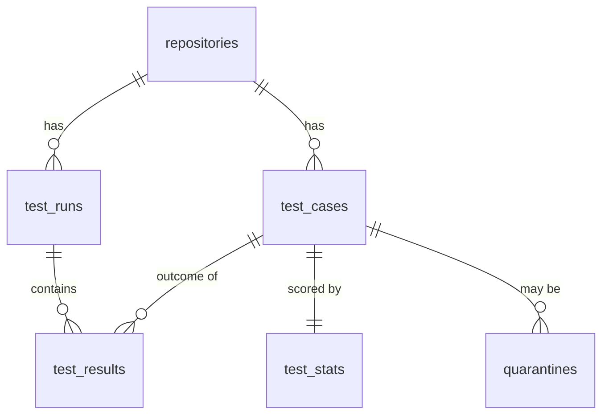

My plan I created with claude:
# FlakeTracker - Project Plan (Claude Code Handoff)

> **Working name:** FlakeTracker (rename freely).
> **What it is:** a cloud-native web application that ingests automated test results from CI pipelines, detects **flaky tests** (tests that pass and fail without code changes), and gives engineers a dashboard to triage and quarantine them.
> **Why this doc exists:** it is the single source of truth for building this project. It captures the university assessment requirements, every decision already made, the architecture, and a phased build plan with acceptance criteria. Read it fully before writing code.

---

## 0. How to use this document (instructions for Claude Code)

1. Work through the **phases in Section 14 in order**. Each phase has a Definition of Done - verify it before moving on.
2. After each phase: run the phase's checks, commit with a clear message, and tick the checkbox in this file.
3. **Ask the owner before** running any command that creates, modifies or deletes GCP resources (clusters, load balancers, disks, registries, IAM). These cost real credit. Local work (Docker, Compose, tests) needs no approval.
4. **Every shell command you write into a script, README or demo file must have a comment explaining what it does and what its parameters mean.** This is an explicit marking requirement (Section 2.4). No uncommented commands anywhere in the repo.
5. The owner must present and defend this code live in a 2-minute Q&A. **Prefer simple, readable, idiomatic code over clever abstractions.** Use the standard library where reasonable. Explain non-obvious patterns in code comments.
6. Never commit secrets. Use `.env.example` files and Kubernetes Secrets created by a commented script.
7. Never use the `latest` image tag in Kubernetes. Tag images with the git commit SHA (enables rollout history and rollback).
8. Do not add major technologies beyond Section 6 without asking. Stretch items (Section 13) come last.

---

## 1. Owner & environment context

| Item | Value |
|---|---|
| Course | INFS3208 Cloud Computing, University of Queensland, Semester 2 2026 |
| Assessment | Individual Project, **Type I - Highly scalable and available web application** |
| GCP project ID | `infs3200-project` (the name contains a typo from creation; it is the correct ID - do not "fix" it) |
| Preferred region/zone | `australia-southeast2` (Melbourne), zone `australia-southeast2-b` used previously |
| Prior experience | Docker, Docker Compose, GKE, StatefulSets + `volumeClaimTemplates`, headless Services, ConfigMaps, Secrets, PVCs, `fsGroup`, LoadBalancer Services, Cloud Shell + `kubectl` |
| Languages | TypeScript (frontend + small tooling scripts), Go (all backend services) |
| GCP credit | Limited - cost hygiene matters (Section 12) |

---

## 2. Assessment specification (summarised from the official task sheet and rubric)

### 2.1 Overview
- Worth **20 marks**: **Proposal (5)** + **Implementation (15)**.
- **Due: 3:00 PM Wednesday 21 October 2026** (Week 12) on Blackboard - proposal **and** source code in the same deadline.
- Implementation is **marked in person** by a tutor in **Week 13** via a live presentation/demo.

### 2.2 Proposal requirements (5 marks)
- **Max 1,000 words, max two A4 pages**, submitted as PDF or DOCX.
- Required sections and marks:

| Section | Sub-item | Marks |
|---|---|---|
| Introduction (2.5) | Background: what is the project about? | 0.5 |
| | Motivation: why is it important? | 0.5 |
| | Overall objective and features | 0.5 |
| | Limitations of traditional (non-cloud) computing solutions | 0.5 |
| | Benefits of cloud computing for this project | 0.5 |
| Technical Solutions (1.5) | Cloud technologies used (frontend and backend) | 1.0 |
| | **Monthly cost estimate** of all cloud resources (must be reasonable; use GCP Pricing Calculator) | 0.5 |
| Architecture Design (1) | Figure depicting the workflow/framework (e.g., microservice diagram) | 1.0 |

### 2.3 Type I technical requirements (from the task sheet)
- **Frontend:** functional UI that lets users interact with the app, with **at least 4 different functionalities**.
- **Backend:** e.g., a database working together with the frontend.
- **Containerisation:** Docker, **multiple containers in a microservice architecture**.
- **Orchestration:** Docker Swarm **or Kubernetes** orchestrating multiple containers **across hosts** (→ the cluster must have **≥2 nodes**; we use 3).
- Must be scalable, reliable and resilient; must support **rolling updates and rollback**.

### 2.4 Presentation rules (from the marking notes)
- **Strictly 4 minutes.** Overrunning loses marks. **2 minutes Q&A.**
- **Marks deducted for technical disruptions during the demo, e.g. scaling failures.** → The demo must be rehearsed and have fallbacks.
- **Each submitted command must have clear comments explaining its function and parameters.**
- **The application must be fully deployed to the cloud.** Local-only demos lose marks.
- Presentation should cover: background & motivation; architecture & technologies; **database design** (Type I); results & discussion.

### 2.5 Submission contents
- Proposal PDF/DOCX (≤1,000 words, 2 pages).
- One compressed file containing: **source code, README with deployment instructions, relevant data** (or an external link if data is too large).
- Filename: the spec does not state a convention; follow the course's previous convention to be safe: `FirstName_LastName_StudentNo.zip`.
- Back up code at least weekly (the GitHub repo satisfies this).

### 2.6 Implementation rubric - Type I (15 marks)

| Rubric item | Marks | How FlakeTracker satisfies it | Demo evidence |
|---|---|---|---|
| Frontend: interactive UI | 1 | React + TypeScript SPA with dashboard, leaderboard, test detail charts, quarantine management, run explorer | Live UI tour |
| Backend: database design and usage | 1 | PostgreSQL with 6 normalised tables, constraints and indexes (Section 8) | ERD slide + live data |
| ≥4 frontend/backend functionalities | 1 | 5 functionalities (Section 5) | UI tour |
| Microservice architecture + containerisation | 2 | 4 app services (`web`, `ingest`, `api`, `analyzer`) + Postgres, each in its own container, split by workload profile | Architecture slide, `kubectl get pods` |
| Scalability | 1 | HorizontalPodAutoscaler on `ingest` and `api`; k6 load test triggers scale-out | `kubectl get hpa -w` during k6 |
| Reliability | 1 | ≥2 replicas per stateless service, spread across nodes, PodDisruptionBudgets, readiness probes, idempotent ingest | Delete a pod / drain a node during load; k6 error rate stays ~0 |
| Load balancing | 1 | GKE Ingress → Google Cloud HTTP(S) Load Balancer with path routing; Services balance across replicas | Show Ingress + requests spread across pods |
| Orchestration (Swarm or K8s) | 3 | GKE Standard, 3 nodes; Deployments, StatefulSet, Services, Ingress, ConfigMap, Secret, HPA, PDB, Job | Manifests + live cluster |
| Rollout and rollback | 1 | RollingUpdate (maxUnavailable 0), SHA-tagged images, change-cause annotations, deliberate bad release → `kubectl rollout undo` | Live rollout + rollback |
| Originality, innovation, difficulty, completeness | 3 | Real-world DevOps problem; polyglot services; CI/CD with GitHub Actions; live Playwright data source; flakiness scoring algorithm | Whole demo |

> **Rubric ambiguity to resolve:** the extracted rubric lists two items - *"Data size and complexity: ≥10,000 records, multiple data files or tables" (1)* and *"Data storage" (1)* - directly after the Type I block. The Type I items above already sum to exactly 15, so these most likely belong to Type II. **Cheap insurance:** the seed generator (Section 11) produces **>10,000 records across multiple tables** anyway. The owner should confirm with a tutor on Ed Discussion.

---

## 3. Product concept

### 3.1 Problem
A **flaky test** is an automated test that sometimes passes and sometimes fails **on the same code**. Flaky tests:
- waste CI time (re-runs), block merges, and erode trust in the test suite ("just re-run it");
- hide real bugs, because genuine failures get dismissed as "probably flaky";
- are hard to spot by eye because each failure looks like a one-off.

Google's Testing Blog (2016, "Flaky Tests at Google and How We Mitigate Them") reported that about 1.5% of test runs produced a flaky result and almost 16% of tests showed some flakiness. *(Verify and cite properly in the proposal.)*

### 3.2 Solution
FlakeTracker collects every test result from every CI run, keeps the history, and computes a **flakiness score** per test. Engineers see a ranked leaderboard of the flakiest tests, drill into each test's pass/fail timeline, and **quarantine** tests so they stop blocking pipelines while being fixed.

### 3.3 Why cloud (proposal talking points)
- **Bursty write traffic:** results arrive in spikes when many pipelines finish together (e.g., a large merge wave). Autoscaling absorbs bursts; a fixed on-prem server must be sized for peak and sits idle otherwise.
- **High availability:** CI pipelines post results unattended; a single server outage loses data. Replicated pods across nodes + load balancing keep ingestion up.
- **Independent scaling:** the write path (ingest), read path (dashboard API) and batch computation (analyzer) have different load profiles, so each scales separately.
- **Pay-as-you-go + scale to zero** when idle; managed Kubernetes removes control-plane operations.
- **Zero-downtime updates:** rolling deployments and instant rollback for a tool that must always be available to CI.

### 3.4 Traditional limitations (proposal talking points)
- Spreadsheets / manual triage don't scale and have no history.
- A single VM running a monolith is a single point of failure, cannot scale parts independently, and updates require downtime.
- Buying hardware for peak load is wasteful; capacity changes are slow.

---

## 4. Decisions log

### 4.1 Locked decisions
| # | Decision | Reason |
|---|---|---|
| D1 | Type I project | Best fit for platform / cloud / DevOps career goals |
| D2 | Backend in **Go**, frontend in **TypeScript + React** | Two languages only (simplified from earlier 3-surface idea); Go suits bursty concurrent HTTP |
| D3 | **Kubernetes on GKE Standard**, 3 nodes, zonal | Rubric orchestration (3 marks) + "across hosts" requirement; prior GKE experience |
| D4 | **PostgreSQL** as a StatefulSet with a PVC | Relational data fits; reuses StatefulSet/PVC knowledge from Assignment 2; cheaper than Cloud SQL |
| D5 | 4 application services: `web`, `ingest`, `api`, `analyzer` | Split by workload profile (static / bursty write / read / batch compute) |
| D6 | **Playwright sample suite is optional, not load-bearing** | Live CI → webhook chain is the biggest demo risk and earns no extra marks; never run it live during the demo |
| D7 | **Seed generator** provides guaranteed demo data | Removes dependence on live CI; also covers the ≥10k-records ambiguity |
| D8 | **GitHub Actions** for CI (tests/build) and CD (build → push → deploy) | Industry-standard; strong originality/resume value |
| D9 | GKE's **built-in Ingress** (Google Cloud HTTP(S) Load Balancer) | No extra controller to install; provisions a real cloud load balancer |
| D10 | Ingest uses an **API key** (Secret); dashboard has **no user login** | Keeps scope tight; login is future work |
| D11 | One **canonical JSON ingest format**; adapters convert tool output into it | Keeps Go ingest simple; Playwright adapter written in TS |

### 4.2 Non-goals (explicitly out of scope unless everything else is done)
- User accounts / login / multi-tenancy.
- Highly available Postgres (single primary is accepted; mention Cloud SQL HA as future work in Q&A).
- Service mesh, JUnit XML ingestion (stretch), Slack/email alerts (stretch).

---

## 5. Functional requirements (the ≥4 functionalities)

| # | Functionality | User story | Services involved |
|---|---|---|---|
| F1 | **Overview dashboard** | As an engineer, I see totals (tests tracked, flaky count, broken count, quarantined count, runs ingested) and a chart of flaky-test count over time. | `web` → `api` |
| F2 | **Flaky test leaderboard** | I see tests ranked by flakiness score, filter by repository/branch/classification, search by name, and paginate. | `web` → `api` |
| F3 | **Test detail & history** | I open a test and see its score breakdown, a pass/fail timeline of recent runs, a duration trend chart, and links to the CI runs. | `web` → `api` |
| F4 | **Quarantine management** | I quarantine a test with a reason (and un-quarantine it later). CI can fetch the quarantine list to skip those tests. | `web` → `api` → DB; CI → `api` |
| F5 | **Run explorer** | I browse ingested CI runs (repo, branch, commit, time, pass/fail counts) and drill into a run's results. | `web` → `api` |
| F0 | **Result ingestion** (machine-facing) | CI posts results after each run; they appear in the dashboard after the next analysis cycle. | CI → `ingest` → DB → `analyzer` |

F1–F5 are the user-facing functionalities shown in the demo; F0 is the backbone.

---

## 6. Technology inventory

| Technology | Used for | Core / Stretch |
|---|---|---|
| **Go** (latest stable) | `ingest`, `api`, `analyzer`, `seed`, `migrate` binaries | Core |
| `net/http` (Go 1.22+ method-aware routing) | HTTP servers - no web framework needed | Core |
| `github.com/jackc/pgx/v5` (+ `pgxpool`) | Postgres driver and connection pool | Core |
| `github.com/golang-migrate/migrate/v4` | SQL schema migrations (run as a Kubernetes Job) | Core |
| `log/slog` | Structured JSON logging | Core |
| **TypeScript + React + Vite** | `web` single-page app | Core |
| React Router, TanStack Query, Recharts | Routing, data fetching/caching, charts | Core |
| **nginx** (unprivileged image) | Serves the built SPA inside the `web` container | Core |
| **PostgreSQL** (pin a major version, e.g. 17) | Primary datastore | Core |
| **Docker** (multi-stage builds, distroless runtime for Go) | Containerisation; small images = fast pulls on GKE | Core |
| **Docker Compose** | Local development and testing before cloud | Core |
| **Kubernetes on GKE Standard** | Orchestration | Core |
| **GKE Ingress** + `BackendConfig` | HTTP(S) load balancer with explicit health checks | Core |
| **HorizontalPodAutoscaler** (metrics-server is built into GKE) | Autoscaling | Core |
| **Artifact Registry** | Container image registry | Core |
| **GitHub Actions** | CI (lint/test/build) + CD (build/push/deploy) | Core |
| **Workload Identity Federation** (`google-github-actions/auth`) | Keyless GitHub → GCP authentication (no JSON keys) | Core (fallback: service-account key stored as a GitHub secret, if WIF blocks progress) |
| **Kustomize** (`kubectl apply -k`) | Image-tag substitution in CD | Core |
| **k6** | Load testing for the scalability/reliability demo | Core |
| **Playwright** | Sample test suite with deliberately flaky tests → realistic live data | Optional (D6) |
| **Terraform** | Provision GKE cluster, node pool, Artifact Registry, WIF as code | Stretch |
| **Cloud Monitoring / Managed Prometheus** | Live dashboards of request rate & pod count | Stretch |

---

## 7. Architecture

### 7.1 Services

| Service | Language | Kind | Replicas | Exposed via | Responsibility |
|---|---|---|---|---|---|
| `web` | TS/React → static files on nginx | Deployment | 2 | Ingress `/` | Dashboard UI |
| `ingest` | Go | Deployment + HPA (2–8) | 2+ | Ingress `/ingest/` | Validate + store CI results (write path, bursty) |
| `api` | Go | Deployment + HPA (2–6) | 2+ | Ingress `/api/` | Read API for the UI; quarantine writes |
| `analyzer` | Go | Deployment | 1 | Internal only (no Service needed except metrics) | Periodically recompute flakiness stats (batch compute) |
| `postgres` | - | StatefulSet + headless Service + PVC | 1 | ClusterIP/headless only | Persistence |
| `migrate` | Go / golang-migrate | Job | run-to-completion | - | Apply schema migrations before app rollout |

**Why this split (say this in the demo):** each service has a different load profile. `ingest` gets bursty writes when pipelines finish; `api` gets read traffic from humans; `analyzer` is CPU-bound batch work that must not slow down requests; `web` is static. Splitting lets each scale, fail and deploy independently (CQRS-style write/read separation).

**Analyzer safety:** it runs with `replicas: 1`, and its writes are **idempotent upserts**, so an accidental second replica or a restart mid-cycle cannot corrupt data.

### 7.2 Diagram (render for the proposal; export to PNG)


### 7.3 Request flows
1. **Ingest:** CI → LB → `ingest` → validate payload → single DB transaction (upsert repo/test cases, insert run + results, `ON CONFLICT DO NOTHING` for duplicates) → `202 Accepted` (or `200` if the run was already ingested).
2. **Analysis:** every `ANALYZER_INTERVAL` (default 60 s), `analyzer` finds test cases with new results since the last cycle, recomputes their stats, upserts `test_stats`.
3. **Read:** browser → LB → `web` (static assets) → the SPA calls `/api/v1/...` → `api` queries Postgres (mostly `test_stats` for fast leaderboard reads).

---

## 8. Data model (PostgreSQL)

### 8.1 Tables

```sql
-- A repository whose CI sends results.
CREATE TABLE repositories (
  id           BIGSERIAL PRIMARY KEY,
  full_name    TEXT NOT NULL UNIQUE,            -- e.g. "shivam/flaky-demo"
  created_at   TIMESTAMPTZ NOT NULL DEFAULT now()
);

-- A logical test, identified by repo + file/suite + title.
CREATE TABLE test_cases (
  id            BIGSERIAL PRIMARY KEY,
  repository_id BIGINT NOT NULL REFERENCES repositories(id) ON DELETE CASCADE,
  suite         TEXT NOT NULL,                  -- e.g. "tests/checkout.spec.ts"
  name          TEXT NOT NULL,                  -- e.g. "adds item to cart"
  first_seen_at TIMESTAMPTZ NOT NULL DEFAULT now(),
  UNIQUE (repository_id, suite, name)
);

-- One CI pipeline execution.
CREATE TABLE test_runs (
  id             BIGSERIAL PRIMARY KEY,
  repository_id  BIGINT NOT NULL REFERENCES repositories(id) ON DELETE CASCADE,
  ci_run_id      TEXT NOT NULL,                 -- e.g. GITHUB_RUN_ID
  ci_run_attempt INT  NOT NULL DEFAULT 1,       -- e.g. GITHUB_RUN_ATTEMPT
  branch         TEXT NOT NULL,
  commit_sha     TEXT NOT NULL,
  run_url        TEXT,
  started_at     TIMESTAMPTZ NOT NULL,
  ingested_at    TIMESTAMPTZ NOT NULL DEFAULT now(),
  UNIQUE (repository_id, ci_run_id, ci_run_attempt)   -- idempotency key
);

-- Final outcome of one test in one run (one row per test per run).
CREATE TABLE test_results (
  id             BIGSERIAL PRIMARY KEY,
  run_id         BIGINT NOT NULL REFERENCES test_runs(id) ON DELETE CASCADE,
  test_case_id   BIGINT NOT NULL REFERENCES test_cases(id) ON DELETE CASCADE,
  final_status   TEXT NOT NULL CHECK (final_status IN ('passed','failed','skipped')),
  attempts       INT  NOT NULL DEFAULT 1,       -- total attempts incl. retries
  passed_on_retry BOOLEAN NOT NULL DEFAULT false, -- failed first, passed later in same run
  duration_ms    INT  NOT NULL,                 -- duration of final attempt
  error_message  TEXT,                          -- first failure message, truncated to 2 KB
  UNIQUE (run_id, test_case_id)
);
CREATE INDEX idx_results_test_case ON test_results (test_case_id, run_id DESC);

-- Precomputed stats, written only by analyzer, read by api.
CREATE TABLE test_stats (
  test_case_id        BIGINT PRIMARY KEY REFERENCES test_cases(id) ON DELETE CASCADE,
  window_size         INT NOT NULL,
  sample_size         INT NOT NULL,
  pass_count          INT NOT NULL,
  fail_count          INT NOT NULL,
  flip_rate           DOUBLE PRECISION NOT NULL,
  retry_pass_rate     DOUBLE PRECISION NOT NULL,
  commit_conflict_rate DOUBLE PRECISION NOT NULL,
  flakiness_score     DOUBLE PRECISION NOT NULL,   -- 0.0 – 1.0
  classification      TEXT NOT NULL CHECK (classification IN ('stable','flaky','broken','insufficient_data')),
  algorithm_version   TEXT NOT NULL,               -- e.g. "v1", "v2" (visible in rollout demo)
  last_result_at      TIMESTAMPTZ,
  computed_at         TIMESTAMPTZ NOT NULL DEFAULT now()
);
CREATE INDEX idx_stats_score ON test_stats (classification, flakiness_score DESC);

-- Quarantine records (history kept; one active per test).
CREATE TABLE quarantines (
  id            BIGSERIAL PRIMARY KEY,
  test_case_id  BIGINT NOT NULL REFERENCES test_cases(id) ON DELETE CASCADE,
  reason        TEXT NOT NULL,
  created_by    TEXT NOT NULL DEFAULT 'dashboard',
  created_at    TIMESTAMPTZ NOT NULL DEFAULT now(),
  released_at   TIMESTAMPTZ                      -- NULL = still active
);
CREATE UNIQUE INDEX uq_active_quarantine ON quarantines (test_case_id) WHERE released_at IS NULL;
```

Adjust types/indexes as needed, but keep: the idempotency unique key on `test_runs`, the one-result-per-test-per-run constraint, and the partial unique index for active quarantines.

### 8.2 ERD (for the presentation "database design" slide)



---

## 9. APIs

### 9.1 `ingest` service

**`POST /ingest/v1/runs`** - header `X-API-Key: <key>` (constant-time comparison against the Secret). Max body 5 MB.

Canonical payload:
```json
{
  "repository": "shivam/flaky-demo",
  "ci_run_id": "123456789",
  "ci_run_attempt": 1,
  "run_url": "https://github.com/shivam/flaky-demo/actions/runs/123456789",
  "branch": "main",
  "commit_sha": "3f9c2a1e...",
  "started_at": "2026-10-01T10:00:00Z",
  "results": [
    {
      "suite": "tests/checkout.spec.ts",
      "name": "adds item to cart",
      "attempts": [
        { "status": "failed", "duration_ms": 5012, "error": "Timeout 5000ms exceeded" },
        { "status": "passed", "duration_ms": 1103 }
      ]
    }
  ]
}
```
Rules:
- `status` ∈ `passed | failed | skipped` (adapters map `timedOut`/`interrupted` → `failed`).
- `final_status` = status of the last attempt; `passed_on_retry` = any failed attempt followed by a later pass.
- Validation errors → `400` with a JSON error body listing problems. Bad key → `401`.
- New run → `202 {"run_id": ..., "results": N}`. Duplicate `(repository, ci_run_id, ci_run_attempt)` → `200 {"run_id": ..., "duplicate": true}`. **This idempotency is what makes client retries safe during the reliability demo.**
- Whole ingest is one transaction.

Also: `GET /healthz` (liveness, no DB), `GET /readyz` (readiness, pings DB).

### 9.2 `api` service
| Method & path | Purpose |
|---|---|
| `GET /api/v1/summary` | Totals + flaky count per day for the last 30 days (F1) |
| `GET /api/v1/repos` | Repository list for filters |
| `GET /api/v1/tests?repo=&classification=&q=&sort=score&limit=50&offset=0` | Leaderboard (F2) |
| `GET /api/v1/tests/{id}` | Test metadata + stats + active quarantine (F3) |
| `GET /api/v1/tests/{id}/history?limit=50` | Recent results with run info (F3) |
| `GET /api/v1/runs?repo=&branch=&limit=&offset=` | Run explorer (F5) |
| `GET /api/v1/runs/{id}` | Run detail with results (F5) |
| `GET /api/v1/quarantine?repo=` | Active quarantine list (F4, also used by CI) |
| `POST /api/v1/quarantine` `{test_case_id, reason}` | Quarantine a test (F4) |
| `DELETE /api/v1/quarantine/{test_case_id}` | Release quarantine (F4) |
| `GET /api/v1/version` | Returns build version + git SHA (**visible in the UI footer - proves which version is live during rollout/rollback**) |
| `GET /healthz`, `GET /readyz` | Probes |

All list endpoints paginate. All responses JSON. CORS not needed (same origin via Ingress).

---

## 10. Flakiness scoring algorithm (`analyzer`)

### 10.1 Inputs (per test case)
The last `WINDOW_SIZE` results (default **30**), ordered by run `started_at`, ignoring `skipped`.

### 10.2 Signals
| Signal | Definition | Why |
|---|---|---|
| `flip_rate` | status changes between consecutive results ÷ (n − 1) | Flaky tests alternate; stable and broken tests don't |
| `retry_pass_rate` | results with `passed_on_retry = true` ÷ n | Strongest per-run evidence of flakiness |
| `commit_conflict_rate` | commits where the test both passed and failed ÷ distinct commits | Same code, different outcome = flaky by definition |
| `fail_rate` | fails ÷ n | Distinguishes *broken* from *flaky* |

### 10.3 Classification (v1)
1. `n < MIN_SAMPLES` (default 5) → `insufficient_data`.
2. Last `BROKEN_STREAK` (default 5) results all failed **and** no retry-passes in that streak → `broken` (consistently failing = a real bug, not flakiness).
3. `flakiness_score ≥ FLAKY_THRESHOLD` (default 0.15) **or** any `commit_conflict` **or** any `retry_pass` in the window → `flaky`.
4. Otherwise → `stable`.

`flakiness_score (v1) = clamp(0.5·flip_rate + 0.3·retry_pass_rate + 0.2·commit_conflict_rate, 0, 1)`

Weights are initial and tunable. All parameters come from the **ConfigMap** so they can change without rebuilding images.

### 10.4 v2 (used for the rollout demo)
Same signals but **recency-weighted**: each result's contribution decays exponentially with age (`HALF_LIFE_DAYS`, default 7). Effect: a test that was flaky last month but recently fixed drops down the leaderboard. `algorithm_version` is written into `test_stats` and shown in the UI, so the marker can *see* the new version take effect, then see rollback restore v1.

Implement both behind an `ALGORITHM_VERSION` build-time default (so v2 is a genuinely new image, not just a config flip) - the rollout demo must be an image change.

### 10.5 Tests
Table-driven Go unit tests covering: always-pass → stable; always-fail → broken; alternating → flaky; single retry-pass → flaky; same-commit conflict → flaky; too few samples → insufficient_data; v2 decays old flakiness.

---

## 11. Data sources

### 11.1 Seed generator (`cmd/seed`) - guaranteed demo data
- Deterministic (`--seed` flag for reproducible data).
- Defaults: 3 repositories, ~150 test cases each (~450 total), ~300 runs per repo over the last 60 days across `main` + a few feature branches → **~135,000 result rows** (well above 10k), spread across multiple tables.
- Test population mix: ~85% stable (fail prob ~0.2%), ~10% flaky (fail prob 5–40%, some with retry-passes and same-commit reruns), ~3% broken (always fail from some date onward), ~2% "fixed" (flaky early, stable recently - makes v1 vs v2 visibly differ).
- Modes: `--mode=api` (POSTs through `ingest` - exercises the real path; also usable as a load generator) and `--mode=db` (direct bulk insert via pgx `CopyFrom` - fast initial load).
- Every flag documented in `--help` and in the README.

### 11.2 Playwright sample suite (`examples/flaky-demo/`) - optional live data (D6)
- A tiny static HTML page served by Playwright's `webServer` config.
- ~10 stable tests, ~4 deliberately flaky tests (e.g., element appears after a random 0–2000 ms delay but the assertion waits 1000 ms; or env-controlled random failure), 1 broken test.
- `playwright.config.ts`: `retries: 2` in CI, `reporter: [['json', { outputFile: 'results.json' }]]`.
- Adapter `scripts/playwright-to-flaketracker.ts`: converts Playwright's JSON report (suites → specs → tests → `results[]` with `retry`, `status`, `duration`, `error`) into the canonical payload, filling CI metadata from `GITHUB_REPOSITORY`, `GITHUB_RUN_ID`, `GITHUB_RUN_ATTEMPT`, `GITHUB_REF_NAME`, `GITHUB_SHA`, `GITHUB_SERVER_URL`. **Inspect a real `results.json` before finalising the mapping.**
- Workflow `.github/workflows/flaky-sample.yml`: `workflow_dispatch` + a schedule; POST step uses `curl` with the API key from GitHub secrets and must tolerate the cluster being down (`continue-on-error: true`). **Disable the schedule whenever the cluster is scaled to zero.**
- **Never trigger this live during the 4-minute demo.** Pre-trigger it 10–15 minutes before the slot.

---

## 12. Cloud infrastructure

### 12.1 Cluster
- GKE **Standard**, **zonal** (`australia-southeast2-b`), release channel Regular.
- Node pool: **3 × `e2-medium`** (2 shared vCPU, 4 GB), 30 GB `pd-balanced` boot disks. 3 nodes lets the reliability demo drain one node and still spread replicas.
- Option to cut cost: Spot VMs for the node pool (cheaper, may be preempted - **do not use Spot during the demo**).
- Artifact Registry Docker repo in the same region.
- **Scale the node pool to 0 whenever not working:** `gcloud container clusters resize <cluster> --node-pool <pool> --num-nodes=0 --zone australia-southeast2-b`.

### 12.2 Kubernetes objects (`deploy/k8s/`)
| File | Objects |
|---|---|
| `00-namespace.yaml` | Namespace `flaketracker` |
| `01-configmap.yaml` | `flaketracker-config`: `WINDOW_SIZE`, `MIN_SAMPLES`, `BROKEN_STREAK`, `FLAKY_THRESHOLD`, `HALF_LIFE_DAYS`, `ANALYZER_INTERVAL`, `DB_HOST`, `DB_NAME`, `LOG_LEVEL` |
| (script) `scripts/k8s/create-secrets.sh` | Secrets `postgres-credentials`, `ingest-api-key` - created by a commented script, never committed |
| `10-postgres.yaml` | Headless Service + StatefulSet (1 replica, `volumeClaimTemplates` 10 Gi RWO), readiness probe `pg_isready`, resources |
| `20-migrate-job.yaml` | Job running migrations; re-run on schema changes |
| `30-ingest.yaml` | Deployment (2), Service (ClusterIP), HPA (2–8, CPU 60%), PDB (minAvailable 1) |
| `31-api.yaml` | Deployment (2), Service, HPA (2–6, CPU 60%), PDB |
| `32-analyzer.yaml` | Deployment (1) |
| `33-web.yaml` | Deployment (2), Service, PDB |
| `40-backendconfig.yaml` | `BackendConfig` per service with explicit health check path |
| `41-ingress.yaml` | Ingress with path rules `/ingest/*`, `/api/*`, `/*` |
| `kustomization.yaml` | Lists resources; `images:` block updated by CD |

Every Deployment must have:
- `resources.requests` **and** `limits` (HPA CPU% is computed against requests - without requests HPA does nothing). Start: Go services `cpu: 100m / memory: 64Mi` requests, `cpu: 500m / memory: 256Mi` limits; tune so the load test visibly triggers scaling.
- `readinessProbe` (`/readyz`) and `livenessProbe` (`/healthz`).
- `strategy: RollingUpdate` with `maxUnavailable: 0`, `maxSurge: 1` (zero-downtime; a broken new version never replaces working pods).
- `topologySpreadConstraints` (or preferred pod anti-affinity) on `kubernetes.io/hostname` so replicas land on different nodes.
- Annotation `kubernetes.io/change-cause` set per release (shows in `kubectl rollout history`).
- `securityContext`: run as non-root; `readOnlyRootFilesystem: true` where possible.
- Env from the ConfigMap (`envFrom.configMapRef`) and Secrets (`secretKeyRef`).

### 12.3 Known gotchas (several learned the hard way in Assignment 2)
- **Postgres on a fresh GKE persistent disk:** the volume root contains `lost+found`, which makes `initdb` fail. Set `PGDATA` to a **subdirectory** of the mount (e.g., `/var/lib/postgresql/data/pgdata`). Pin the Postgres major version; if using Postgres 18+, check the official image docs because its default data-directory layout changed.
- **Non-root containers writing to PVCs** → `Permission denied`. Fix with `securityContext.fsGroup` (this broke both the Jupyter and FAISS pods in Assignment 2).
- **GKE Ingress health checks:** the load balancer marks backends unhealthy unless its health check gets `200`. Use a `BackendConfig` with `healthCheck.requestPath: /healthz` attached via the Service annotation `cloud.google.com/backend-config`. The SPA's nginx must also return `200` on its health path.
- **Load balancer provisioning takes several minutes** after creating the Ingress; don't debug too early.
- **HPA reaction time:** metrics refresh every ~15–60 s and new pods need to pass readiness. In the demo, **start k6 first**, then talk, then show the HPA.
- **Large images pull slowly** (the Assignment 2 Jupyter image was 3.3 GB and took >2 min). Keep Go images on distroless (~10–20 MB) and the web image on nginx-unprivileged.
- `gcloud container clusters get-credentials` must finish before `kubectl` works; if `kubectl` tries `localhost:8080`, credentials weren't set.
- The zone/cluster/project names must be typed exactly as created (typos are permanent - the project ID really is `infs3200-project`).

### 12.4 Monthly cost estimate (for the proposal - **verify every figure in the GCP Pricing Calculator before submitting**)

| Resource | Assumption | Approx. USD / month (24×7) |
|---|---|---|
| GKE cluster management fee | 1 zonal cluster; GKE free tier credit covers one zonal cluster | ~$0 (fee ~$73 offset by free tier) |
| Nodes | 3 × e2-medium on-demand, australia-southeast2 | ~$95–110 |
| Node boot disks | 3 × 30 GB pd-balanced | ~$10–12 |
| Postgres PVC | 10 GB pd-balanced | ~$1–2 |
| HTTP(S) Load Balancer | 1 forwarding rule + light data processing | ~$18–20 |
| Artifact Registry | < 1 GB images (0.5 GB free) | ~$0–1 |
| Network egress | light demo traffic | ~$1–3 |
| **Total (24×7, on-demand)** | | **≈ $125–150** |
| **Realistic dev usage** | nodes scaled to 0 outside work sessions (~30 h/week), Spot nodes while developing | **≈ $25–45** |

Proposal framing: give the 24×7 production figure, then explain cost controls (autoscaling, scale-to-zero outside hours, Spot for non-critical workloads).

---

## 13. CI/CD and stretch goals

### 13.1 GitHub Actions workflows (`.github/workflows/`)
| Workflow | Trigger | Steps |
|---|---|---|
| `ci.yml` | push, pull_request | Go: `go vet`, `go test ./...` (with race detector), optional `golangci-lint`. Web: `npm ci`, `tsc --noEmit`, `npm run build`. Docker: build all images (no push). |
| `cd.yml` | push to `main` (+ `workflow_dispatch`) | Auth to GCP via Workload Identity Federation → `docker build/push` to Artifact Registry tagged with `${GITHUB_SHA}` → `get-gke-credentials` → `kustomize edit set image ...` → `kubectl apply -k deploy/k8s` → `kubectl rollout status` for each Deployment (fail the job if rollout fails). Use a GitHub **environment** (`production`) so deploys can require manual approval. |
| `flaky-sample.yml` | `workflow_dispatch`, schedule | Run Playwright sample, convert report, POST to ingest (Section 11.2). |

WIF setup (document each command with comments in `scripts/gcp/setup-wif.sh`): create a workload identity pool + GitHub OIDC provider restricted to the repo, a deploy service account with `roles/artifactregistry.writer` and `roles/container.developer`, and bind the repo principal to that service account. Verify steps against the current `google-github-actions/auth` README.

### 13.2 Stretch (only after Phases 1–12 are done)
1. **Terraform** (`infra/terraform/`): cluster (remove default pool), node pool, Artifact Registry repo, WIF pool/provider, service account + bindings. Local state is fine; document `init/plan/apply/destroy`.
2. **Observability:** expose `/metrics` (Prometheus client_golang: request count, latency histogram, ingested results counter) and build a Cloud Monitoring dashboard (request rate, pod count, p95 latency) to show during the scaling demo.
3. **JUnit XML ingestion** (`POST /ingest/v1/junit`) for CI-tool independence.
4. **CI integration of quarantine:** the Playwright workflow fetches `/api/v1/quarantine` and skips those tests (`--grep-invert`).

---

## 14. Build phases (do in order)

### Phase 0 - Repository scaffold
- [ ] Monorepo layout (Section 15), root `README.md`, `.gitignore`, `.editorconfig`, `.env.example`.
- [ ] Single Go module at the repo root; `cmd/{ingest,api,analyzer,seed,migrate}`; shared code in `internal/`.
- [ ] `web/` created with Vite React-TS template.
- **Done when:** `go build ./...` and `npm run build` (in `web/`) both succeed.

### Phase 1 - Database
- [ ] Migrations in `db/migrations/` implementing Section 8.
- [ ] `cmd/migrate` (or golang-migrate CLI in a container) applies them.
- [ ] `internal/db` connection pool helper reading env config.
- **Done when:** migrations apply cleanly against a local Postgres container, and roll back cleanly.

### Phase 2 - `ingest` service
- [ ] Payload types, validation, API-key middleware, transactional insert with idempotency.
- [ ] `/healthz`, `/readyz`, structured logs, graceful shutdown on SIGTERM (important for rolling updates - finish in-flight requests).
- [ ] Unit tests for validation and final-status/retry derivation; integration test against Postgres.
- **Done when:** posting the sample payload twice yields `202` then `200 duplicate`, and rows exist once.

### Phase 3 - Seed generator
- [ ] `cmd/seed` per Section 11.1 with both modes.
- **Done when:** `--mode=db` loads >100k results locally in under a minute; `--mode=api` works against local ingest.

### Phase 4 - `analyzer`
- [ ] Scoring v1 + v2 (Section 10), config from env, interval loop, idempotent upserts, `algorithm_version` stored.
- [ ] Table-driven unit tests (Section 10.5).
- **Done when:** after seeding, `test_stats` classifications roughly match the seeded population mix.

### Phase 5 - `api` service
- [ ] All endpoints in Section 9.2 with pagination and input validation; `/api/v1/version` returns build info injected via `-ldflags`.
- **Done when:** every endpoint returns correct data against the seeded DB; handler tests pass.

### Phase 6 - `web` frontend
- [ ] Pages: Overview (F1), Leaderboard (F2), Test detail (F3), Quarantine (F4), Runs (F5).
- [ ] Charts: flaky count over time; per-test pass/fail timeline; duration trend.
- [ ] Footer shows `api` version/SHA and algorithm version.
- [ ] Clean, readable design; loading and error states; responsive enough for a projector.
- **Done when:** all five functionalities work end-to-end locally.

### Phase 7 - Containers + local Compose
- [ ] Multi-stage Dockerfile for Go (build arg `SERVICE`, distroless nonroot runtime).
- [ ] Web Dockerfile (node build stage → nginx-unprivileged), nginx config with SPA fallback and a health path.
- [ ] `deploy/compose/docker-compose.yml`: postgres (healthcheck), migrate (runs once), ingest, api, analyzer, web, plus a local reverse proxy mimicking Ingress paths. Use `depends_on: condition: service_healthy`.
- **Done when:** `docker compose up` gives a fully working app at `http://localhost:8080`, and the seed runs against it.

### Phase 8 - Playwright sample (optional, can run in parallel with 9–10)
- [ ] Suite + adapter + workflow per Section 11.2.
- **Done when:** a manual workflow run lands results that show up as flaky in the dashboard.

### Phase 9 - GKE deployment (ask owner before creating cloud resources)
- [ ] Commented scripts: `scripts/gcp/create-cluster.sh`, `create-registry.sh`, `scripts/k8s/create-secrets.sh`, `scale-down.sh`, `scale-up.sh`.
- [ ] Manifests per Section 12.2; manual first deploy with `kubectl apply -k`.
- **Done when:** app reachable on the Ingress IP; all pods Ready; replicas spread across nodes (`kubectl get pods -o wide`).

### Phase 10 - Scalability & reliability
- [ ] `scripts/loadtest/ingest.js` (k6): ramping VUs posting realistic payloads with unique run IDs; thresholds `http_req_failed < 1%`.
- [ ] Optional `scripts/loadtest/api.js` for read load on the leaderboard.
- [ ] Tune requests/HPA so scale-out is visible within ~60–90 s.
- [ ] Reliability drills: `kubectl delete pod` of an ingest replica under load; `kubectl drain` one node under load - record k6 error rate.
- **Done when:** both drills complete with near-zero failed requests, and HPA scales out and back in.

### Phase 11 - CI/CD
- [ ] `ci.yml`, `cd.yml`, WIF setup script, GitHub environment.
- [ ] Prove rollout: merge a visible change → CD deploys → UI footer shows new SHA.
- [ ] Prove rollback: `kubectl rollout undo deployment/<name> -n flaketracker` restores the previous version.
- **Done when:** a push to `main` deploys automatically with rollout status checks.

### Phase 12 - Docs, demo, submission
- [ ] README: overview, architecture, prerequisites, local run, GKE deploy, CI/CD setup, teardown - **every command commented**.
- [ ] `docs/architecture.md` (Mermaid source + exported PNG), `docs/erd.png`, `docs/demo-script.md`, `docs/proposal.md` (≤1,000 words).
- [ ] `scripts/demo/` - one commented script per demo segment.
- [ ] Submission ZIP builder script (excludes `node_modules`, build outputs, secrets).
- **Done when:** a fresh clone can be deployed by following the README alone.

### Phase 13 - Stretch goals (Section 13.2)

---

## 15. Repository layout

```
flaketracker/
├── README.md
├── PROJECT_PLAN.md                 # this file
├── go.mod / go.sum
├── cmd/
│   ├── ingest/main.go
│   ├── api/main.go
│   ├── analyzer/main.go
│   ├── seed/main.go
│   └── migrate/main.go
├── internal/
│   ├── config/        # env parsing
│   ├── db/            # pgx pool, queries
│   ├── model/         # shared types
│   ├── ingest/        # payload validation + persistence
│   ├── scoring/       # v1/v2 algorithms (pure functions, heavily tested)
│   ├── httpx/         # middleware: logging, API key, recover, health
│   └── version/       # build info via -ldflags
├── db/migrations/
├── web/                           # Vite + React + TS
│   ├── src/{pages,components,api,hooks}
│   ├── Dockerfile
│   └── nginx.conf
├── build/Dockerfile.go            # multi-stage, ARG SERVICE
├── deploy/
│   ├── compose/docker-compose.yml
│   └── k8s/ (Section 12.2)
├── infra/terraform/               # stretch
├── examples/flaky-demo/           # Playwright sample suite
├── scripts/
│   ├── gcp/        # cluster, registry, WIF, scale up/down (commented)
│   ├── k8s/        # secrets, deploy helpers (commented)
│   ├── loadtest/   # k6 scripts
│   ├── demo/       # per-segment demo commands (commented)
│   ├── playwright-to-flaketracker.ts
│   └── make-submission-zip.sh
├── docs/
│   ├── architecture.md / architecture.png
│   ├── erd.png
│   ├── proposal.md
│   └── demo-script.md
└── .github/workflows/{ci.yml,cd.yml,flaky-sample.yml}
```

---

## 16. Demo script (strictly 4 minutes)

**Before the slot (30+ min earlier):** scale nodes up; confirm all pods Ready; open the UI; pre-trigger the Playwright workflow; prepare terminal tabs running the scripts in `scripts/demo/`; have v2 and a deliberately broken v3 image already pushed; **record a full backup video of a successful rehearsal** in case of network failure.

| Time | Segment | What to show |
|---|---|---|
| 0:00–0:30 | Background & motivation | One slide: flaky tests problem + why cloud. **Start the k6 load test now** (it needs time to trigger the HPA). |
| 0:30–0:50 | Architecture & DB design | Architecture diagram + ERD; one sentence on why services are split. |
| 0:50–1:40 | Functionalities | Overview → leaderboard (filter) → test detail timeline → quarantine a test → run explorer. |
| 1:40–2:20 | Scalability + load balancing | `kubectl get hpa -n flaketracker -w` and `kubectl get pods -o wide` showing new ingest pods on multiple nodes; k6 summary. |
| 2:20–2:50 | Reliability | Delete an ingest pod (or drain a node) while k6 runs; show pods recreated and k6 error rate ~0. |
| 2:50–3:40 | Rollout & rollback | `kubectl set image` (or CD) to **v2** → footer shows v2 + algorithm v2, leaderboard re-ranks. Deploy broken **v3** → rollout stalls, old pods keep serving (maxUnavailable 0) → `kubectl rollout undo` → `kubectl rollout history`. |
| 3:40–4:00 | Results & discussion | Cost, limitations (single Postgres, no auth), future work. |

Rehearse with a timer at least three times. Cut the drain-node step first if running long.

---

## 17. Proposal outline (≤1,000 words, 2 pages)

| Section | Word budget | Content source in this plan |
|---|---|---|
| Introduction - background | ~90 | §3.1 |
| Introduction - motivation | ~90 | §3.1 (cite Google stat properly) |
| Introduction - objective & features | ~120 | §3.2, §5 (F1–F5) |
| Introduction - traditional limitations | ~90 | §3.4 |
| Introduction - cloud benefits | ~110 | §3.3 |
| Technical solutions - technologies | ~220 | §6 (frontend + backend + infra + CI/CD) |
| Technical solutions - monthly cost | ~100 + table | §12.4 (verified figures) |
| Architecture design | figure + ~80 caption | §7.2 diagram |
| **Total** | **≈ 900–1,000** | |

Write in plain, clear academic language. Put the architecture figure and cost table in so they fit on two A4 pages.

---

## 18. Open questions for the owner / tutor
1. Confirm whether the "≥10,000 records / multiple tables" and "data storage" rubric items apply to Type I (the seed data covers them either way).
2. Confirm a pre-recorded backup video is acceptable if the live demo has a network failure.
3. Confirm submission ZIP naming convention.
4. Confirm use of external tooling (GitHub Actions, Terraform, k6) is fine - the spec encourages "new technologies" for the competition, so it should be.

---

## 19. Final checklist before submission
- [ ] App fully deployed on GKE and reachable via the Ingress IP.
- [ ] 5 functionalities work in the cloud deployment.
- [ ] HPA scale-out rehearsed and reliable; reliability drill rehearsed.
- [ ] Rollout (v2) and rollback (from broken v3) rehearsed.
- [ ] Every command in README, scripts and demo files has a comment.
- [ ] Proposal ≤1,000 words, ≤2 pages, includes verified monthly cost and architecture figure.
- [ ] ZIP contains source, README/deployment instructions, seed script (data), no secrets, no `node_modules`.
- [ ] Nodes scaled to 0 after marking; cluster, load balancer, disks and registry deleted once grades are final.

Full official task sheet & marking criteria (lines 727–1152) - matches what was already summarized in Sections 1–2 of the plan, just now in the original source form. No new information, just corroboration.
Practical 5: Docker Compose II & Kubernetes (lines 1153–1720) - directly relevant to our build. Covers VM firewall rules, a 4-container Docker Compose stack (nginx/PHP-FPM/MariaDB/Redis), creating a GKE cluster (zonal, 3× n1-standard-2, Ubuntu+containerd, 50GB balanced disk) or a local Kind cluster, and basic stateless Deployment/scale/delete commands. This is useful reference material for Phase 7 (Compose) and Phase 9 (GKE) - worth keeping in mind, especially the GKE cluster creation walkthrough and the scale-to-zero commands, which line up with what's already in Section 12.
Practical 6: Vector DB with Faiss, Practical 7: CRUD in Redis/MongoDB, Practical 8: Spark RDD Programming (lines 1722–2422) - these are Type II (Big Data) practical materials. Not applicable to FlakeTracker since we're doing Type I. I'll disregard these unless you tell me otherwise.
One thing worth noting: Practical 5's GKE walkthrough uses n1-standard-2 nodes and a 50GB boot disk, while our plan (Section 12.1) specifies e2-medium and 30GB - that's fine, the practical is just a generic teaching example and our plan's sizing is a deliberate cost-optimization choice, but flagging in case you want to align them.

Now let me check the gcloud CLI install.


Bash Check gcloud CLI version
IN
gcloud --version 2>&1

OUT
Exit code 127
/usr/bin/bash: line 1: gcloud: command not found
PowerShell Check common gcloud CLI install locations
IN
$paths = @("C:\Users\shiva\AppData\Local\Google\Cloud SDK\google-cloud-sdk\bin\gcloud.cmd", "C:\Program Files (x86)\Google\Cloud SDK\google-cloud-sdk\bin\gcloud.cmd", "C:\Program Files\Google\Cloud SDK\google-cloud-sdk\bin\gcloud.cmd"); foreach ($p in $paths) { Write-Output "$p : $(Test-Path $p)" }

OUT
C:\Users\shiva\AppData\Local\Google\Cloud SDK\google-cloud-sdk\bin\gcloud.cmd : True
C:\Program Files (x86)\Google\Cloud SDK\google-cloud-sdk\bin\gcloud.cmd : False
C:\Program Files\Google\Cloud SDK\google-cloud-sdk\bin\gcloud.cmd : False
Found it - installed at C:\Users\shiva\AppData\Local\Google\Cloud SDK\. Same PATH-staleness story as Go: this session/terminal started before the installer updated PATH, so it's not visible yet in this shell.


Bash Verify gcloud binary works via full path
IN
"/c/Users/shiva/AppData/Local/Google/Cloud SDK/google-cloud-sdk/bin/gcloud.cmd" --version 2>&1

OUT
Google Cloud SDK 586.0.0
bq 2.1.38
core 2026.09.20
gcloud-crc32c 1.0.0
gsutil 5.37
gcloud SDK 586.0.0 is installed and working. Once you fully restart VS Code (same fix as for Go - it's just a stale-PATH issue, not a broken install), both go and gcloud should resolve normally in the integrated terminal.

Where things stand:

Go ✅ installed, works once VS Code is restarted
gcloud ✅ installed, works once VS Code is restarted
kubectl ✅ already working
Node/npm/Docker ✅ already working
Once you've restarted and confirmed both commands work, the next real step is authenticating gcloud (gcloud auth login + gcloud config set project infs3200-project) so we can do read-only checks against your GCP project - still no cluster/resource creation until Phase 9 and with your explicit go-ahead.


ok I've restarted, what to do now
Let's verify Go and gcloud now resolve on PATH, then confirm the Phase 0 build and get gcloud authenticated.


Bash Check that go and gcloud now resolve on PATH
IN
go version 2>&1; echo "---"; gcloud --version 2>&1

OUT
go version go1.27.1 windows/amd64
---
Google Cloud SDK 586.0.0
bq 2.1.38
core 2026.09.20
gcloud-crc32c 1.0.0
gsutil 5.37
Both resolve normally now. Let's confirm Phase 0's build still passes cleanly with the real go command, then check gcloud auth status (read-only - no resources touched).


Bash Verify go build succeeds via normal PATH resolution
IN
cd "/c/Users/shiva/Desktop/infs3208-flaketracker" && go build ./... && echo "GO BUILD OK"

OUT
GO BUILD OK
Bash Check current gcloud authentication status
IN
gcloud auth list 2>&1

OUT
     Credentialed Accounts
ACTIVE  ACCOUNT
*       shivammtrivedi@gmail.com

To set the active account, run:
    $ gcloud config set account `ACCOUNT`
Both check out:

go build ./... - clean, Phase 0's Go side is fully confirmed now on the real toolchain.
gcloud is already authenticated as shivammtrivedi@gmail.com.
Let's confirm the active project is set correctly (read-only).


Bash Check active gcloud project and verify project access
IN
gcloud config get-value project 2>&1; echo "---"; gcloud projects describe infs3200-project 2>&1

OUT
The server-side auto mode classifier gave no verdict (error), so auto mode cannot determine the safety of Bash. This is a transient failure of the check, not a judgment about the action: a later response may get a verdict. You may try the action again once, as-is. Repeated attempts are slowed by a growing delay, and after 10 responses in a row without a verdict the turn stops. If it keeps failing, continue with other tasks that don't require this action and come back to it later. Note: reading files, searching code, and other read-only operations do not require the classifier and can still be used.
Bash Check active gcloud project and verify project access
IN
gcloud config get-value project 2>&1; echo "---"; gcloud projects describe infs3200-project 2>&1

OUT
The server-side auto mode classifier gave no verdict (error), so auto mode cannot determine the safety of Bash. This is a transient failure of the check, not a judgment about the action: a later response may get a verdict. You may try the action again once, as-is. Repeated attempts are slowed by a growing delay, and after 10 responses in a row without a verdict the turn stops. If it keeps failing, continue with other tasks that don't require this action and come back to it later. Note: reading files, searching code, and other read-only operations do not require the classifier and can still be used.
PowerShell Check active gcloud project and verify project access
IN
gcloud config get-value project; Write-Output "---"; gcloud projects describe infs3200-project

OUT
The server-side auto mode classifier gave no verdict (error), so auto mode cannot determine the safety of PowerShell. This is a transient failure of the check, not a judgment about the action: a later response may get a verdict. You may try the action again once, as-is. Repeated attempts are slowed by a growing delay, and after 10 responses in a row without a verdict the turn stops. If it keeps failing, continue with other tasks that don't require this action and come back to it later. Note: reading files, searching code, and other read-only operations do not require the classifier and can still be used.
That command hit a transient classifier failure on both Bash and PowerShell (not a rejection - the safety check itself is temporarily unavailable). I'll move on and we can retry that specific check later; in the meantime, here's where things stand and what's next.

Confirmed so far:

Go and gcloud both resolve correctly post-restart.
go build ./... passes cleanly - Phase 0's Go side is fully verified.
gcloud is authenticated as shivammtrivedi@gmail.com.
Next steps, in order:

You can run gcloud config set project infs3200-project yourself right now if it isn't already set (I'll verify with a describe call once the classifier recovers, or you can just run gcloud projects describe infs3200-project and paste the output).
Stage and commit the Phase 0 scaffold (that's on you, as you asked earlier).
Move into Phase 1 - Database: write the migrations in db/migrations/ implementing Section 8's schema, plus internal/db (pgx pool helper) and cmd/migrate. This is the next actual coding phase and doesn't touch GCP at all - just needs a local Postgres (e.g. via Docker) to test against.
Want me to start on Phase 1 (migrations + internal/db + cmd/migrate) now?


PS C:\Users\shiva\Desktop\infs3208-flaketracker> gcloud config set project infs3200-project
Updated property [core/project].
PS C:\Users\shiva\Desktop\infs3208-flaketracker> gcloud projects describe infs3200-project
createTime: '2026-08-05T04:25:14.736Z'
lifecycleState: ACTIVE
name: INFS3200 Project
projectId: infs3200-project
projectNumber: '237441063783'
Show more
Confirmed - project infs3200-project is active and reachable, gcloud is fully wired up. All toolchain checks are done:

Tool	Status
Go 1.27.1	✅
Node/npm	✅
Docker/Compose	✅
kubectl	✅
gcloud	✅ authenticated, project set


Next up: Phase 2 - ingest service (payload types, validation, API-key middleware, transactional insert with idempotency, health checks, graceful shutdown). Want me to continue straight into that?


c:\Users\shiva\Desktop\infs3208-flaketracker\PROJECT_PLAN_3208.md
yeah let's write that up, can you also add comments in the go files explaining what everything does, since this is my first time using or writing anything in go. When you're done briefly explain the go syntax, the framework/s other stuff we are using and how it all works together and if you can relate to how a python fastapi or spring app would work since I'm used to those
Show less
Let me write Phase 2 now - I'll comment these files heavily since this is your first Go code, explaining the language mechanics as I go, not just what the project-specific logic does.


Write c:\Users\shiva\Desktop\infs3208-flaketracker\internal\httpx\httpx.go
134 lines
// Package httpx provides shared HTTP middleware: logging, API-key auth, panic
// recovery, and Kubernetes health checks. It's used by every HTTP-serving
// binary (ingest, api) so this logic is written once.
//
// Background for readers new to Go: an http.Handler is any type with a method
// `ServeHTTP(w http.ResponseWriter, r *http.Request)`. "Middleware" is just a
// function that takes a Handler and returns a new Handler wrapping it - the
// same idea as a decorator in Python (e.g. FastAPI's @app.middleware) or a
// Filter/Interceptor in Spring, just without a framework providing the
// wiring: in Go you nest the wrapping calls yourself (see cmd/ingest/main.go).
package httpx

import (
	"context"
	"crypto/subtle"
	"log/slog"
	"net/http"
	"time"

	"github.com/jackc/pgx/v5/pgxpool"
)

// WithLogging wraps a handler so every request is logged with its method,
// path, status code, and how long it took.
func WithLogging(next http.Handler) http.Handler {
	// http.HandlerFunc is a type: "a function with this exact signature".
	// Converting our closure `func(w, r) {...}` to http.HandlerFunc is what
	// lets a plain function satisfy the http.Handler interface - Go doesn't
	// have "implements" keywords, a type satisfies an interface just by
	// having the right methods, and HandlerFunc's one method is itself.
	return http.HandlerFunc(func(w http.ResponseWriter, r *http.Request) {
		start := time.Now()

		// Plain http.ResponseWriter has no way to ask "what status code did
		// the handler send?" after the fact, so we wrap it in a small
		// recorder that remembers the status for the log line below.
		rec := &statusRecorder{ResponseWriter: w, status: http.StatusOK}

		next.ServeHTTP(rec, r)

		slog.Info("request",
			"method", r.Method,
			"path", r.URL.Path,
			"status", rec.status,
			"duration_ms", time.Since(start).Milliseconds(),
		)
	})
}

// statusRecorder decorates http.ResponseWriter to capture the status code
// the wrapped handler writes.
//
// Embedding http.ResponseWriter as an unnamed field (just the type, no field
// name) means statusRecorder automatically gets all of ResponseWriter's
// methods "for free" - this is Go's version of inheritance/composition. We
// only need to override the one method we care about, WriteHeader.
type statusRecorder struct {
	http.ResponseWriter
	status int
}

func (r *statusRecorder) WriteHeader(status int) {
	r.status = status
	r.ResponseWriter.WriteHeader(status)
}

// WithRecover wraps a handler so a panic inside it becomes a 500 response
// instead of crashing the whole process (one bad request should never take
// down the other in-flight requests a Go server is handling concurrently).
func WithRecover(next http.Handler) http.Handler {
	return http.HandlerFunc(func(w http.ResponseWriter, r *http.Request) {
		// `defer` schedules a function call to run right before the
		// surrounding function returns - including when it returns because
		// of a panic. `recover()` only has an effect when called inside a
		// deferred function; it stops the panic from propagating further up
		// the call stack and gives us back whatever value was panicked with.
		defer func() {
			if err := recover(); err != nil {
				slog.Error("panic recovered", "error", err, "path", r.URL.Path)
				http.Error(w, "internal server error", http.StatusInternalServerError)
			}
		}()
		next.ServeHTTP(w, r)
	})
}

// RequireAPIKey wraps a handler so requests must present a valid X-API-Key
// header matching key. The caller (main.go) is responsible for making sure
// key is non-empty before wiring this up - an empty configured key would
// otherwise match an empty (missing) header.
func RequireAPIKey(key string, next http.Handler) http.Handler {
	return http.HandlerFunc(func(w http.ResponseWriter, r *http.Request) {
		got := r.Header.Get("X-API-Key")

		// subtle.ConstantTimeCompare takes the same amount of time no matter
		// where two byte slices first differ. A plain `got == key` check
		// would return as soon as it finds a mismatched byte, and an
		// attacker who can measure response time precisely enough could use
		// that to guess the key one byte at a time. This only matters
		// because we're comparing a secret; ordinary string comparisons
		// elsewhere in the codebase don't need this.
		if subtle.ConstantTimeCompare([]byte(got), []byte(key)) != 1 {
			http.Error(w, "unauthorized", http.StatusUnauthorized)
			return
		}
		next.ServeHTTP(w, r)
	})
}

// Healthz is a liveness probe: it only proves the process is alive and able
// to respond, so it deliberately never touches the database. Kubernetes
// restarts a pod that fails this.
func Healthz(w http.ResponseWriter, r *http.Request) {
	w.WriteHeader(http.StatusOK)
}

// Readyz is a readiness probe: it pings the database, so Kubernetes only
// routes traffic to this pod once it can actually serve a request. Returning
// a function (a closure) here, rather than a plain function, is how this
// handler "remembers" the pool it needs - Go has no dependency-injection
// container, so handlers carry their own dependencies like this instead.
func Readyz(pool *pgxpool.Pool) http.HandlerFunc {
	return func(w http.ResponseWriter, r *http.Request) {
		ctx, cancel := context.WithTimeout(r.Context(), 2*time.Second)
		defer cancel()

		if err := pool.Ping(ctx); err != nil {
			http.Error(w, "not ready", http.StatusServiceUnavailable)
			return
		}
		w.WriteHeader(http.StatusOK)
	}
}
Write c:\Users\shiva\Desktop\infs3208-flaketracker\internal\ingest\payload.go
171 lines
// Package ingest validates and persists incoming CI test-run payloads -
// the canonical JSON format described in Section 9.1 of the project plan.
package ingest

import (
	"fmt"
	"time"
)

// Status is the outcome of a single test attempt. Go doesn't have a built-in
// enum type; the idiomatic substitute is a named string type plus a fixed
// set of constants, which is what this is. Because the underlying type is
// still `string`, encoding/json can decode straight into it with no extra
// code, and `switch` statements below can still do exhaustive-style checks.
type Status string

const (
	StatusPassed  Status = "passed"
	StatusFailed  Status = "failed"
	StatusSkipped Status = "skipped"
)

// RunPayload is the JSON body posted to POST /ingest/v1/runs.
//
// The `json:"..."` text after each field is a "struct tag" - metadata
// attached to the field that the encoding/json package reads via reflection
// to decide how to map JSON keys to Go fields. This plays the same role as
// field aliases on a Pydantic BaseModel in FastAPI, or @JsonProperty in a
// Spring/Jackson DTO: it's what lets snake_case JSON map onto CamelCase Go.
type RunPayload struct {
	Repository   string          `json:"repository"`
	CIRunID      string          `json:"ci_run_id"`
	CIRunAttempt int             `json:"ci_run_attempt"`
	RunURL       string          `json:"run_url"`
	Branch       string          `json:"branch"`
	CommitSHA    string          `json:"commit_sha"`
	StartedAt    time.Time       `json:"started_at"`
	Results      []ResultPayload `json:"results"`
}

// ResultPayload is one test's outcome within a run: its identity, plus every
// attempt made at it (a test may be retried, producing more than one).
type ResultPayload struct {
	Suite    string           `json:"suite"`
	Name     string           `json:"name"`
	Attempts []AttemptPayload `json:"attempts"`
}

// AttemptPayload is a single execution of one test.
type AttemptPayload struct {
	Status     Status `json:"status"`
	DurationMs int    `json:"duration_ms"`
	Error      string `json:"error"`
}

// Validate checks the payload against the rules in Section 9.1 and returns a
// human-readable problem string for each thing that's wrong.
//
// Go has no exceptions - functions that can fail return an error value (or,
// here, a slice of them) instead of throwing. Returning every problem at
// once (rather than stopping at the first, the way a single `error` would)
// is what lets the HTTP handler satisfy the spec's "400 with a JSON error
// body listing problems" requirement in one round trip.
//
// The receiver `p *RunPayload` (a pointer) rather than `p RunPayload` (a
// copy) matters here: this method also fills in the default for
// CIRunAttempt below, and that mutation needs to be visible to the caller.
func (p *RunPayload) Validate() []string {
	var problems []string

	if p.Repository == "" {
		problems = append(problems, "repository is required")
	}
	if p.CIRunID == "" {
		problems = append(problems, "ci_run_id is required")
	}
	if p.Branch == "" {
		problems = append(problems, "branch is required")
	}
	if p.CommitSHA == "" {
		problems = append(problems, "commit_sha is required")
	}
	if p.StartedAt.IsZero() {
		problems = append(problems, "started_at is required")
	}
	if p.CIRunAttempt == 0 {
		// Section 9.1: ci_run_attempt defaults to 1 when the field is omitted
		// from the JSON body (Go zero-initialises a missing int field to 0).
		p.CIRunAttempt = 1
	}

	for i, result := range p.Results {
		if result.Suite == "" {
			problems = append(problems, fmt.Sprintf("results[%d].suite is required", i))
		}
		if result.Name == "" {
			problems = append(problems, fmt.Sprintf("results[%d].name is required", i))
		}
		if len(result.Attempts) == 0 {
			problems = append(problems, fmt.Sprintf("results[%d].attempts must have at least one entry", i))
		}
		for j, attempt := range result.Attempts {
			switch attempt.Status {
			case StatusPassed, StatusFailed, StatusSkipped:
				// valid, nothing to report
			default:
				problems = append(problems, fmt.Sprintf("results[%d].attempts[%d].status %q is invalid", i, j, attempt.Status))
			}
		}
	}

	return problems
}

// derived is what actually gets stored for one test result, computed from
// its raw attempts per the rules in Section 9.1. Keeping this as its own
// (unexported - lowercase name, so only this package can see it) type keeps
// the derivation logic testable in isolation from both JSON decoding and SQL.
type derived struct {
	FinalStatus   Status
	Attempts      int
	PassedOnRetry bool
	DurationMs    int
	ErrorMessage  string
}

// deriveResult applies Section 9.1's rules to one test's attempts:
//   - final_status is the status of the last attempt.
//   - passed_on_retry is true if the test failed at least once before that
//     final, successful attempt.
//   - error_message is the first failure's message, truncated to 2 KB.
func deriveResult(attempts []AttemptPayload) derived {
	last := attempts[len(attempts)-1]

	d := derived{
		FinalStatus: last.Status,
		Attempts:    len(attempts),
		DurationMs:  last.DurationMs,
	}

	if d.FinalStatus == StatusPassed {
		// attempts[:len(attempts)-1] is a slice expression: "every element
		// except the last one". We only care about earlier failures if the
		// test ultimately passed.
		for _, a := range attempts[:len(attempts)-1] {
			if a.Status == StatusFailed {
				d.PassedOnRetry = true
				break
			}
		}
	}

	for _, a := range attempts {
		if a.Status == StatusFailed && a.Error != "" {
			d.ErrorMessage = truncate(a.Error, 2048)
			break
		}
	}

	return d
}

// truncate cuts s down to at most max bytes, leaving it unchanged if it's
// already shorter.
func truncate(s string, max int) string {
	if len(s) <= max {
		return s
	}
	return s[:max]
}
Write c:\Users\shiva\Desktop\infs3208-flaketracker\internal\ingest\store.go
136 lines
package ingest

import (
	"context"
	"errors"

	"github.com/jackc/pgx/v5"
	"github.com/jackc/pgx/v5/pgxpool"
)

// InsertResult is what the HTTP handler needs to know after trying to store
// a run: whether it was newly written, and if not, why not.
type InsertResult struct {
	RunID     int64
	Duplicate bool
	Results   int
}

// Insert stores one CI run and all its test results inside a single database
// transaction (Section 7.3, step 1). Wrapping everything in one transaction
// means either the whole run is saved, or none of it is - a partially
// ingested run (say, half its test results missing) would silently corrupt
// the flakiness statistics the analyzer computes later.
func Insert(ctx context.Context, pool *pgxpool.Pool, p *RunPayload) (InsertResult, error) {
	// Begin a transaction. `tx` can be used for queries just like `pool`
	// below, but none of its writes are permanent until Commit is called.
	tx, err := pool.Begin(ctx)
	if err != nil {
		return InsertResult{}, err
	}
	// `defer tx.Rollback(ctx)` runs no matter how this function returns -
	// including via an early `return` on error. If we already reached
	// Commit successfully, calling Rollback afterwards on a finished
	// transaction is a documented no-op. This "defer a cleanup, commit
	// explicitly on the happy path" pattern is the standard way Go handles
	// "undo unless I explicitly finished" logic, since there's no automatic
	// scope-exit destructor like a Python `with` block or Java try-with-resources.
	defer tx.Rollback(ctx)

	// Upsert the repository. "ON CONFLICT ... DO UPDATE" (rather than
	// DO NOTHING) is a deliberate trick: DO NOTHING wouldn't let us RETURN
	// the id of the row that already existed, so we do a harmless no-op
	// update instead purely to get RETURNING to fire either way.
	var repositoryID int64
	err = tx.QueryRow(ctx,
		`INSERT INTO repositories (full_name) VALUES ($1)
		 ON CONFLICT (full_name) DO UPDATE SET full_name = EXCLUDED.full_name
		 RETURNING id`,
		p.Repository,
	).Scan(&repositoryID)
	if err != nil {
		return InsertResult{}, err
	}

	// Insert the run. Here we deliberately use ON CONFLICT ... DO NOTHING:
	// (repository_id, ci_run_id, ci_run_attempt) is the idempotency key from
	// Section 9.1, so a conflict means "this exact run was already
	// ingested" and we want to detect that, not silently overwrite it.
	var runID int64
	err = tx.QueryRow(ctx,
		`INSERT INTO test_runs (repository_id, ci_run_id, ci_run_attempt, branch, commit_sha, run_url, started_at)
		 VALUES ($1, $2, $3, $4, $5, $6, $7)
		 ON CONFLICT (repository_id, ci_run_id, ci_run_attempt) DO NOTHING
		 RETURNING id`,
		repositoryID, p.CIRunID, p.CIRunAttempt, p.Branch, p.CommitSHA, nullableString(p.RunURL), p.StartedAt,
	).Scan(&runID)

	// pgx.ErrNoRows here doesn't mean something broke - QueryRow always
	// expects exactly one row back, and "ON CONFLICT DO NOTHING" returns
	// zero rows precisely when the conflict happened. `errors.Is` is Go's
	// way of checking "is this error (or one it wraps) equal to that
	// sentinel error", similar in spirit to `except SpecificError:` in
	// Python, but without exceptions: err is just a value we inspect.
	if errors.Is(err, pgx.ErrNoRows) {
		err = tx.QueryRow(ctx,
			`SELECT id FROM test_runs WHERE repository_id = $1 AND ci_run_id = $2 AND ci_run_attempt = $3`,
			repositoryID, p.CIRunID, p.CIRunAttempt,
		).Scan(&runID)
		if err != nil {
			return InsertResult{}, err
		}
		if err := tx.Commit(ctx); err != nil {
			return InsertResult{}, err
		}
		return InsertResult{RunID: runID, Duplicate: true}, nil
	}
	if err != nil {
		return InsertResult{}, err
	}

	// This is a brand-new run, so insert every test result. `for _, result
	// := range p.Results` is Go's for-each loop: range gives back
	// (index, value) pairs, and `_` throws away the index we don't need here.
	for _, result := range p.Results {
		var testCaseID int64
		err = tx.QueryRow(ctx,
			`INSERT INTO test_cases (repository_id, suite, name) VALUES ($1, $2, $3)
			 ON CONFLICT (repository_id, suite, name) DO UPDATE SET name = EXCLUDED.name
			 RETURNING id`,
			repositoryID, result.Suite, result.Name,
		).Scan(&testCaseID)
		if err != nil {
			return InsertResult{}, err
		}

		d := deriveResult(result.Attempts)

		_, err = tx.Exec(ctx,
			`INSERT INTO test_results (run_id, test_case_id, final_status, attempts, passed_on_retry, duration_ms, error_message)
			 VALUES ($1, $2, $3, $4, $5, $6, $7)`,
			runID, testCaseID, string(d.FinalStatus), d.Attempts, d.PassedOnRetry, d.DurationMs, nullableString(d.ErrorMessage),
		)
		if err != nil {
			return InsertResult{}, err
		}
	}

	if err := tx.Commit(ctx); err != nil {
		return InsertResult{}, err
	}

	return InsertResult{RunID: runID, Results: len(p.Results)}, nil
}

// nullableString turns an empty Go string into a real SQL NULL instead of
// storing an empty string in a nullable text column. It returns `any`
// (Go's alias for `interface{}`, the type that can hold a value of any
// type) because that's what pgx's query parameters accept, and `nil` is
// how you spell "NULL" when passing a Go value into a SQL query.
func nullableString(s string) any {
	if s == "" {
		return nil
	}
	return s
}
Write c:\Users\shiva\Desktop\infs3208-flaketracker\internal\ingest\handler.go
71 lines
package ingest

import (
	"encoding/json"
	"log/slog"
	"net/http"

	"github.com/jackc/pgx/v5/pgxpool"
)

// maxBodyBytes caps request bodies at 5 MB (Section 9.1), so a malicious or
// buggy client can't exhaust server memory with an oversized payload.
const maxBodyBytes = 5 << 20 // 5 * 1024 * 1024, using a bit-shift the way Go code conventionally spells byte sizes

// NewHandler returns the HTTP handler for POST /ingest/v1/runs.
//
// Returning a closure that captures `pool` is Go's usual substitute for
// dependency injection: rather than a framework wiring a database connection
// into a controller (as Spring's @Autowired or FastAPI's Depends() would),
// the handler function itself just closes over whatever it needs.
func NewHandler(pool *pgxpool.Pool) http.HandlerFunc {
	return func(w http.ResponseWriter, r *http.Request) {
		// http.MaxBytesReader makes any read past maxBodyBytes fail, so
		// json.Decode below can't be tricked into reading an unbounded body.
		r.Body = http.MaxBytesReader(w, r.Body, maxBodyBytes)

		var payload RunPayload
		if err := json.NewDecoder(r.Body).Decode(&payload); err != nil {
			writeJSON(w, http.StatusBadRequest, map[string]any{
				"errors": []string{"invalid JSON: " + err.Error()},
			})
			return
		}

		if problems := payload.Validate(); len(problems) > 0 {
			writeJSON(w, http.StatusBadRequest, map[string]any{"errors": problems})
			return
		}

		// r.Context() carries the request's lifecycle: if the client
		// disconnects or the request times out, anything downstream using
		// this context (here, the database call) can notice and stop early
		// instead of doing wasted work.
		result, err := Insert(r.Context(), pool, &payload)
		if err != nil {
			slog.Error("ingest: insert failed", "error", err)
			http.Error(w, "internal server error", http.StatusInternalServerError)
			return
		}

		if result.Duplicate {
			// Section 9.1: a duplicate (repository, ci_run_id, ci_run_attempt)
			// is a 200, not an error - this is what makes client retries safe.
			writeJSON(w, http.StatusOK, map[string]any{"run_id": result.RunID, "duplicate": true})
			return
		}
		writeJSON(w, http.StatusAccepted, map[string]any{"run_id": result.RunID, "results": result.Results})
	}
}

// writeJSON is a small helper so every response in this file is built the
// same way: set the content type, write the status, then encode the body.
func writeJSON(w http.ResponseWriter, status int, body any) {
	w.Header().Set("Content-Type", "application/json")
	w.WriteHeader(status)
	// Encoding errors here would mean the client already has a broken
	// connection (there's no useful way to report an error while writing
	// the error response itself), so we deliberately ignore it with `_`.
	_ = json.NewEncoder(w).Encode(body)
}
Now update internal/config to add ingest-specific config, then wire up cmd/ingest/main.go.


Read c:\Users\shiva\Desktop\infs3208-flaketracker\internal\config\config.go
Edit c:\Users\shiva\Desktop\infs3208-flaketracker\internal\config\config.go
Added 14 lines
Now cmd/ingest/main.go - this is where everything gets wired together.


Write c:\Users\shiva\Desktop\infs3208-flaketracker\cmd\ingest\main.go
117 lines
// main.go is the entry point for the "ingest" binary. In Go, `package main`
// combined with a `func main()` is what makes a program executable - every
// Go program that runs standalone (as opposed to a library package) needs
// exactly one of these, comparable to the `if __name__ == "__main__":` guard
// in Python or a `public static void main` in Java, except mandatory.
package main

import (
	"context"
	"errors"
	"log/slog"
	"net/http"
	"os"
	"os/signal"
	"syscall"
	"time"

	"flaketracker/internal/config"
	"flaketracker/internal/db"
	"flaketracker/internal/httpx"
	"flaketracker/internal/ingest"
)

func main() {
	// slog is Go's standard structured logger. NewJSONHandler makes every
	// log line a JSON object on stdout - this is what "structured JSON
	// logging" (Section 6) means in practice, and it's what lets a log
	// aggregator (or a human with `jq`) filter/query logs instead of
	// grep-ing free-form text.
	slog.SetDefault(slog.New(slog.NewJSONHandler(os.Stdout, nil)))

	cfg := config.LoadIngest()
	if cfg.APIKey == "" {
		// Fail fast at startup rather than at request time: an empty
		// configured key would otherwise match an empty (missing) header in
		// httpx.RequireAPIKey, silently letting every request through.
		slog.Error("INGEST_API_KEY is not set")
		os.Exit(1)
	}

	// context.Background() is the root of every context tree in a Go
	// program - an empty starting point with no deadline and no values.
	// signal.NotifyContext derives a child context that gets cancelled the
	// instant the process receives SIGINT (Ctrl+C locally) or SIGTERM (what
	// Kubernetes sends a pod before killing it). This is how Go does
	// graceful shutdown: instead of dying mid-request, the code below gets a
	// chance to notice ctx.Done() and shut down in an orderly way.
	ctx, stop := signal.NotifyContext(context.Background(), os.Interrupt, syscall.SIGTERM)
	defer stop()

	pool, err := db.NewPool(ctx)
	if err != nil {
		slog.Error("failed to create database pool", "error", err)
		os.Exit(1)
	}
	// `defer pool.Close()` guarantees the pool is closed when main() returns
	// - including via the graceful-shutdown path below - the same "clean up
	// on the way out" pattern used in internal/ingest/store.go for transactions.
	defer pool.Close()

	// http.NewServeMux is Go's built-in router. Since Go 1.22, patterns can
	// include an HTTP method (e.g. "POST /path"), so the mux itself rejects
	// a GET to an ingest-only route without any extra code - no separate
	// routing library needed for a service this small.
	mux := http.NewServeMux()
	mux.Handle("POST /ingest/v1/runs", httpx.RequireAPIKey(cfg.APIKey, ingest.NewHandler(pool)))
	mux.HandleFunc("GET /healthz", httpx.Healthz)
	mux.HandleFunc("GET /readyz", httpx.Readyz(pool))

	// Middleware wrapping reads inside-out: a request hits WithLogging
	// first, which calls WithRecover, which calls mux. This nesting is the
	// entire "middleware chain" - there's no separate concept or framework
	// hook for it in the standard library.
	handler := httpx.WithLogging(httpx.WithRecover(mux))

	srv := &http.Server{
		Addr:         ":" + cfg.Port,
		Handler:      handler,
		ReadTimeout:  10 * time.Second,
		WriteTimeout: 10 * time.Second,
	}

	// `go func() { ... }()` starts a goroutine: a lightweight, concurrently
	// scheduled function call (cheaper than an OS thread - a Go program can
	// run thousands of these). We run the server in one so that main() can
	// move on to the `<-ctx.Done()` line below and wait for a shutdown
	// signal while the server handles requests in the background.
	go func() {
		slog.Info("ingest listening", "port", cfg.Port)
		if err := srv.ListenAndServe(); err != nil && !errors.Is(err, http.ErrServerClosed) {
			// ListenAndServe always returns a non-nil error; ErrServerClosed
			// specifically means "someone called srv.Shutdown", which is the
			// expected, non-error way this goroutine ends.
			slog.Error("server failed", "error", err)
			os.Exit(1)
		}
	}()

	// `<-ctx.Done()` receives from the context's Done channel. A channel
	// receive blocks until there's something to receive - here, that's
	// "until ctx is cancelled". This line is what makes main() sit idle,
	// serving requests via the goroutine above, until a shutdown signal
	// arrives.
	<-ctx.Done()
	slog.Info("shutting down")

	// Give in-flight requests up to 10 seconds to finish before forcing the
	// server closed - this is what "graceful shutdown on SIGTERM" (Phase 2)
	// means: a rolling Kubernetes update shouldn't cut off a request that
	// was already halfway through.
	shutdownCtx, cancel := context.WithTimeout(context.Background(), 10*time.Second)
	defer cancel()
	if err := srv.Shutdown(shutdownCtx); err != nil {
		slog.Error("graceful shutdown failed", "error", err)
	}
}
Now let's add PORT to .env.example and write the unit tests, then build and verify.


Read c:\Users\shiva\Desktop\infs3208-flaketracker\.env.example
Edit c:\Users\shiva\Desktop\infs3208-flaketracker\.env.example
Added 3 lines
Now the unit tests for validation and derivation logic.


Write c:\Users\shiva\Desktop\infs3208-flaketracker\internal\ingest\payload_test.go
154 lines
// This file lives in `package ingest` (not `ingest_test`) specifically so it
// can call unexported names like deriveResult and truncate directly - Go
// only enforces "unexported = private to the package", and a _test.go file
// declaring the same package counts as part of it.
package ingest

import (
	"strings"
	"testing"
	"time"
)

// Go's built-in testing style is "table-driven": one slice of input/expected
// pairs, one loop that runs them all through t.Run. There's no assertion
// library in the standard library (no assertEqual) - you compare values
// yourself and call t.Errorf/t.Fatalf to report a failure.
func TestValidate(t *testing.T) {
	tests := []struct {
		name    string
		payload RunPayload
		wantErr bool
	}{
		{
			name: "valid minimal payload",
			payload: RunPayload{
				Repository: "shivam/flaky-demo",
				CIRunID:    "1",
				Branch:     "main",
				CommitSHA:  "abc123",
				StartedAt:  time.Now(),
				Results: []ResultPayload{
					{Suite: "a.spec.ts", Name: "does a thing", Attempts: []AttemptPayload{{Status: StatusPassed}}},
				},
			},
			wantErr: false,
		},
		{
			name:    "missing every required field",
			payload: RunPayload{},
			wantErr: true,
		},
		{
			name: "invalid attempt status",
			payload: RunPayload{
				Repository: "r", CIRunID: "1", Branch: "main", CommitSHA: "abc", StartedAt: time.Now(),
				Results: []ResultPayload{
					{Suite: "a", Name: "b", Attempts: []AttemptPayload{{Status: "timedOut"}}},
				},
			},
			wantErr: true,
		},
		{
			name: "result with no attempts",
			payload: RunPayload{
				Repository: "r", CIRunID: "1", Branch: "main", CommitSHA: "abc", StartedAt: time.Now(),
				Results: []ResultPayload{{Suite: "a", Name: "b"}},
			},
			wantErr: true,
		},
	}

	for _, tt := range tests {
		// Capturing `tt` as a local inside the loop body (the `tt := tt`
		// idiom isn't needed here since Go 1.22 fixed loop-variable capture,
		// but t.Run's own closure is what makes each case show up as its own
		// named sub-test in `go test -v` output).
		t.Run(tt.name, func(t *testing.T) {
			problems := tt.payload.Validate()
			if got := len(problems) > 0; got != tt.wantErr {
				t.Errorf("Validate() returned problems=%v (len=%d), want error=%v", problems, len(problems), tt.wantErr)
			}
		})
	}
}

func TestValidateDefaultsCIRunAttempt(t *testing.T) {
	p := RunPayload{
		Repository: "r", CIRunID: "1", Branch: "main", CommitSHA: "abc", StartedAt: time.Now(),
	}
	p.Validate()
	if p.CIRunAttempt != 1 {
		t.Errorf("CIRunAttempt = %d, want 1 (the Section 9.1 default when omitted)", p.CIRunAttempt)
	}
}

func TestDeriveResult(t *testing.T) {
	tests := []struct {
		name              string
		attempts          []AttemptPayload
		wantFinal         Status
		wantPassedOnRetry bool
		wantAttempts      int
	}{
		{
			name:         "single pass",
			attempts:     []AttemptPayload{{Status: StatusPassed}},
			wantFinal:    StatusPassed,
			wantAttempts: 1,
		},
		{
			name:              "failed then passed on retry",
			attempts:          []AttemptPayload{{Status: StatusFailed}, {Status: StatusPassed}},
			wantFinal:         StatusPassed,
			wantPassedOnRetry: true,
			wantAttempts:      2,
		},
		{
			name:         "always fails",
			attempts:     []AttemptPayload{{Status: StatusFailed}, {Status: StatusFailed}},
			wantFinal:    StatusFailed,
			wantAttempts: 2,
		},
		{
			name:         "skipped",
			attempts:     []AttemptPayload{{Status: StatusSkipped}},
			wantFinal:    StatusSkipped,
			wantAttempts: 1,
		},
	}

	for _, tt := range tests {
		t.Run(tt.name, func(t *testing.T) {
			d := deriveResult(tt.attempts)
			if d.FinalStatus != tt.wantFinal {
				t.Errorf("FinalStatus = %v, want %v", d.FinalStatus, tt.wantFinal)
			}
			if d.PassedOnRetry != tt.wantPassedOnRetry {
				t.Errorf("PassedOnRetry = %v, want %v", d.PassedOnRetry, tt.wantPassedOnRetry)
			}
			if d.Attempts != tt.wantAttempts {
				t.Errorf("Attempts = %d, want %d", d.Attempts, tt.wantAttempts)
			}
		})
	}
}

func TestDeriveResultCapturesFirstFailureMessage(t *testing.T) {
	d := deriveResult([]AttemptPayload{
		{Status: StatusFailed, Error: "first failure"},
		{Status: StatusFailed, Error: "second failure"},
	})
	if d.ErrorMessage != "first failure" {
		t.Errorf("ErrorMessage = %q, want %q", d.ErrorMessage, "first failure")
	}
}

func TestDeriveResultTruncatesErrorMessage(t *testing.T) {
	longError := strings.Repeat("x", 3000)
	d := deriveResult([]AttemptPayload{{Status: StatusFailed, Error: longError}})
	if len(d.ErrorMessage) != 2048 {
		t.Errorf("ErrorMessage length = %d, want 2048", len(d.ErrorMessage))
	}
}
Now the integration test against a real Postgres, gated behind a build tag so go test ./... never needs a database to pass.


Write c:\Users\shiva\Desktop\infs3208-flaketracker\internal\ingest\store_integration_test.go
80 lines
//go:build integration

// The line above is a Go "build tag": this file is excluded from a normal
// `go build` or `go test ./...` and only compiles when explicitly requested
// with `go test -tags=integration ./...`. That keeps CI's default test run
// fast and database-free, while still letting this test exist for anyone
// (or any pipeline) that has a real Postgres to point at.
package ingest

import (
	"context"
	"os"
	"testing"
	"time"

	"github.com/jackc/pgx/v5/pgxpool"
)

// TestInsertIdempotency is the Phase 2 acceptance check from the project
// plan, expressed as a test: posting the same run twice must insert it once
// and report the second attempt as a duplicate, with matching run IDs.
func TestInsertIdempotency(t *testing.T) {
	dsn := os.Getenv("TEST_DATABASE_URL")
	if dsn == "" {
		t.Skip("TEST_DATABASE_URL not set; skipping integration test")
	}

	pool, err := pgxpool.New(context.Background(), dsn)
	if err != nil {
		t.Fatalf("connect: %v", err)
	}
	defer pool.Close()

	payload := &RunPayload{
		Repository: "test/repo",
		CIRunID:    "integration-test-1",
		Branch:     "main",
		CommitSHA:  "deadbeef",
		StartedAt:  time.Now(),
		Results: []ResultPayload{
			{Suite: "a.spec.ts", Name: "works", Attempts: []AttemptPayload{{Status: StatusPassed}}},
		},
	}
	payload.Validate()

	first, err := Insert(context.Background(), pool, payload)
	if err != nil {
		t.Fatalf("first insert: %v", err)
	}
	if first.Duplicate {
		t.Fatalf("first insert reported as duplicate, want new")
	}
	if first.Results != 1 {
		t.Fatalf("first insert reported %d results, want 1", first.Results)
	}

	second, err := Insert(context.Background(), pool, payload)
	if err != nil {
		t.Fatalf("second insert: %v", err)
	}
	if !second.Duplicate {
		t.Fatalf("second insert not reported as duplicate, want duplicate")
	}
	if second.RunID != first.RunID {
		t.Fatalf("duplicate run_id = %d, want %d (same run as the first insert)", second.RunID, first.RunID)
	}

	var count int
	err = pool.QueryRow(context.Background(),
		`SELECT count(*) FROM test_results tr JOIN test_runs r ON r.id = tr.run_id WHERE r.id = $1`,
		first.RunID,
	).Scan(&count)
	if err != nil {
		t.Fatalf("count results: %v", err)
	}
	if count != 1 {
		t.Fatalf("test_results row count = %d, want 1 (rows must exist once, not twice)", count)
	}
}
Now let's build, vet, and run the unit tests.


Bash Build and vet the whole module
IN
cd "/c/Users/shiva/Desktop/infs3208-flaketracker" && go build ./... 2>&1 && echo "---BUILD OK---" && go vet ./... 2>&1 && echo "---VET OK---"

OUT
---BUILD OK---
---VET OK---
Bash Run unit tests with verbose output
IN
cd "/c/Users/shiva/Desktop/infs3208-flaketracker" && go test ./... -v 2>&1

OUT
?   	flaketracker/cmd/analyzer	[no test files]
?   	flaketracker/cmd/api	[no test files]
?   	flaketracker/cmd/ingest	[no test files]
?   	flaketracker/cmd/migrate	[no test files]
?   	flaketracker/cmd/seed	[no test files]
?   	flaketracker/internal/config	[no test files]
?   	flaketracker/internal/db	[no test files]
?   	flaketracker/internal/httpx	[no test files]
=== RUN   TestValidate
=== RUN   TestValidate/valid_minimal_payload
=== RUN   TestValidate/missing_every_required_field
=== RUN   TestValidate/invalid_attempt_status
=== RUN   TestValidate/result_with_no_attempts
--- PASS: TestValidate (0.00s)
    --- PASS: TestValidate/valid_minimal_payload (0.00s)
    --- PASS: TestValidate/missing_every_required_field (0.00s)
    --- PASS: TestValidate/invalid_attempt_status (0.00s)
    --- PASS: TestValidate/result_with_no_attempts (0.00s)
=== RUN   TestValidateDefaultsCIRunAttempt
--- PASS: TestValidateDefaultsCIRunAttempt (0.00s)
=== RUN   TestDeriveResult
=== RUN   TestDeriveResult/single_pass
=== RUN   TestDeriveResult/failed_then_passed_on_retry
=== RUN   TestDeriveResult/always_fails
=== RUN   TestDeriveResult/skipped
--- PASS: TestDeriveResult (0.00s)
    --- PASS: TestDeriveResult/single_pass (0.00s)
    --- PASS: TestDeriveResult/failed_then_passed_on_retry (0.00s)
    --- PASS: TestDeriveResult/always_fails (0.00s)
    --- PASS: TestDeriveResult/skipped (0.00s)
=== RUN   TestDeriveResultCapturesFirstFailureMessage
--- PASS: TestDeriveResultCapturesFirstFailureMessage (0.00s)
=== RUN   TestDeriveResultTruncatesErrorMessage
--- PASS: TestDeriveResultTruncatesErrorMessage (0.00s)
PASS
ok  	flaketracker/internal/ingest	0.458s
?   	flaketracker/internal/model	[no test files]
?   	flaketracker/internal/scoring	[no test files]
?   	flaketracker/internal/version	[no test files]
All unit tests pass. Now let's do the full end-to-end check per Phase 2's DoD: a real Postgres, a running ingest server, and posting the same payload twice to confirm 202 then 200 duplicate.


Bash Start a fresh local Postgres container for the ingest end-to-end test
IN
docker run --rm -d --name flaketracker-test-pg -e POSTGRES_PASSWORD=changeme -e POSTGRES_USER=flaketracker -e POSTGRES_DB=flaketracker -p 5432:5432 postgres:17 2>&1 | tail -1

OUT
151d6d581d44b07efa4db0ba81c4190531f79c2b10ab1888958c914f307c96b2
Bash Wait for Postgres and apply migrations
IN
cd "/c/Users/shiva/Desktop/infs3208-flaketracker" && for i in $(seq 1 20); do docker exec flaketracker-test-pg pg_isready -U flaketracker >/dev/null 2>&1 && echo "ready" && break; sleep 1; done && DB_HOST=localhost DB_PORT=5432 DB_NAME=flaketracker DB_USER=flaketracker DB_PASSWORD=changeme go run ./cmd/migrate --direction=up 2>&1

OUT
ready
2026/09/29 14:29:21 migrate: done
Now start the ingest server in the background and hit it with the sample payload twice.


Bash Start the ingest server in the background
IN
cd "/c/Users/shiva/Desktop/infs3208-flaketracker" && DB_HOST=localhost DB_PORT=5432 DB_NAME=flaketracker DB_USER=flaketracker DB_PASSWORD=changeme INGEST_API_KEY=test-key PORT=8090 go run ./cmd/ingest > /tmp/ingest.log 2>&1 &
echo "started with pid $!"
sleep 2
cat /tmp/ingest.log

OUT
Command running in background with ID: b20aysq1h. Output is being written to: C:\Users\shiva\AppData\Local\Temp\claude\c--Users-shiva-Desktop-infs3208-flaketracker\3dab8d69-5704-4e6c-b7dc-075815af8e2c\tasks\b20aysq1h.output. You will be notified when it completes. To check interim output, use Read on that file path.
Session cwd remains C:\Users\shiva\Desktop\infs3208-flaketracker; directory changes made by the backgrounded command do not apply to subsequent commands.
Bash Check ingest server is up via healthz endpoint
IN
sleep 2 && curl -s -o /dev/null -w "%{http_code}\n" http://localhost:8090/healthz 2>&1

OUT
200
Background command "Start the ingest server in the background" completed (exit code 0)
Good, the server responded 200 on /healthz - it's running. Now let's post the sample payload twice and check for 202 then 200 duplicate.


Bash POST the sample payload for the first time, expecting 202
IN
curl -s -o /tmp/resp1.json -w "%{http_code}\n" -X POST http://localhost:8090/ingest/v1/runs \
  -H "X-API-Key: test-key" -H "Content-Type: application/json" \
  -d '{
    "repository": "shivam/flaky-demo",
    "ci_run_id": "123456789",
    "ci_run_attempt": 1,
    "run_url": "https://github.com/shivam/flaky-demo/actions/runs/123456789",
    "branch": "main",
    "commit_sha": "3f9c2a1e",
    "started_at": "2026-10-01T10:00:00Z",
    "results": [
      {
        "suite": "tests/checkout.spec.ts",
        "name": "adds item to cart",
        "attempts": [
          { "status": "failed", "duration_ms": 5012, "error": "Timeout 5000ms exceeded" },
          { "status": "passed", "duration_ms": 1103 }
        ]
      }
    ]
  }'
cat /tmp/resp1.json; echo

OUT
202
{"results":1,"run_id":1}
First POST returned 202 as expected. Now let's post the identical payload again to confirm idempotency.


Bash POST the same payload again, expecting 200 duplicate
IN
curl -s -o /tmp/resp2.json -w "%{http_code}\n" -X POST http://localhost:8090/ingest/v1/runs \
  -H "X-API-Key: test-key" -H "Content-Type: application/json" \
  -d '{
    "repository": "shivam/flaky-demo",
    "ci_run_id": "123456789",
    "ci_run_attempt": 1,
    "run_url": "https://github.com/shivam/flaky-demo/actions/runs/123456789",
    "branch": "main",
    "commit_sha": "3f9c2a1e",
    "started_at": "2026-10-01T10:00:00Z",
    "results": [
      {
        "suite": "tests/checkout.spec.ts",
        "name": "adds item to cart",
        "attempts": [
          { "status": "failed", "duration_ms": 5012, "error": "Timeout 5000ms exceeded" },
          { "status": "passed", "duration_ms": 1103 }
        ]
      }
    ]
  }'
cat /tmp/resp2.json; echo

OUT
200
{"duplicate":true,"run_id":1}
Exactly matches Phase 2's DoD: 202 then 200 duplicate, same run_id. Let's confirm rows exist exactly once in the database, then check what changed in main.go, and clean up.


Bash Verify rows exist exactly once with correctly derived fields
IN
docker exec flaketracker-test-pg psql -U flaketracker -d flaketracker -c "SELECT count(*) AS runs FROM test_runs; SELECT count(*) AS results FROM test_results; SELECT final_status, attempts, passed_on_retry, duration_ms, error_message FROM test_results;" 2>&1

OUT
 runs 
------
    1
(1 row)

 results 
---------
       1
(1 row)

 final_status | attempts | passed_on_retry | duration_ms |      error_message      
--------------+----------+-----------------+-------------+-------------------------
 passed       |        2 | t               |        1103 | Timeout 5000ms exceeded
(1 row)
All correct - one run, one result row, and the derivation logic worked exactly right: final_status=passed (last attempt), attempts=2, passed_on_retry=true (failed then passed), duration_ms=1103 (last attempt), error_message captured from the failed attempt.


Bash Stop the ingest server process and the test Postgres container
IN
kill $(powershell -Command "(Get-NetTCPConnection -LocalPort 8090 -ErrorAction SilentlyContinue).OwningProcess" 2>/dev/null) 2>/dev/null; taskkill //F //IM go.exe 2>&1; taskkill //F //FI "WINDOWTITLE eq ingest*" 2>&1
docker stop flaketracker-test-pg 2>&1

OUT
SUCCESS: The process "go.exe" with PID 17588 has been terminated.

INFO: No tasks running with the specified criteria.
flaketracker-test-pg
Bash Confirm the ingest server is no longer responding
IN
curl -s -o /dev/null -w "%{http_code}\n" --max-time 2 http://localhost:8090/healthz 2>&1; echo "exit: $?"

OUT
200
exit: 0
Still running - go run's child binary survived killing the go.exe build wrapper. Let me find and kill the actual server process.


PowerShell Find and kill the process listening on port 8090
IN
$conn = Get-NetTCPConnection -LocalPort 8090 -ErrorAction SilentlyContinue
if ($conn) {
  $procId = $conn.OwningProcess
  Write-Output "Found PID: $procId"
  Get-Process -Id $procId | Select-Object Id, ProcessName, Path
  Stop-Process -Id $procId -Force
  Write-Output "Killed."
} else {
  Write-Output "No process found listening on 8090"
}

OUT
Found PID: 37412

   Id ProcessName Path                                                                    
   -- ----------- ----                                                                    
37412 ingest      C:\Users\shiva\AppData\Local\Temp\go-build1799856110\b001\exe\ingest.exe
Killed.
Bash Confirm the server is down and no docker containers remain
IN
curl -s -o /dev/null -w "%{http_code}\n" --max-time 2 http://localhost:8090/healthz 2>&1; echo "exit: $?"; echo "---"; docker ps -a 2>&1

OUT
000
exit: 28
---
CONTAINER ID   IMAGE                  COMMAND             CREATED        STATUS                     PORTS                              NAMES
be834c4f98d6   qdrant/qdrant:latest   "./entrypoint.sh"   2 months ago   Exited (255) 5 hours ago   0.0.0.0:6333-6334->6333-6334/tcp   se_corpus_qdrant
Confirmed clean - server process killed, test Postgres container gone (the one leftover qdrant container is unrelated to this project and pre-existing, I left it alone).

Phase 2 - ingest service: complete and verified
Files written (all heavily commented, explained below):

internal/ingest/payload.go - RunPayload/ResultPayload/AttemptPayload types, Validate(), and deriveResult() (final status / retry / error-message logic).
internal/ingest/store.go - Insert(): the transactional, idempotent DB write.
internal/ingest/handler.go - the HTTP handler wiring decode → validate → insert → respond.
internal/httpx/httpx.go - logging, panic-recovery, API-key, and health-check middleware (shared, will be reused by api in Phase 5).
internal/config/config.go - added Ingest config (port, API key).
cmd/ingest/main.go - wires it all together with graceful shutdown.
internal/ingest/payload_test.go - unit tests for validation and derivation (all passing).
internal/ingest/store_integration_test.go - integration test against a real Postgres (behind a build tag, skipped by default).
Verified live, end-to-end, matching Phase 2's Definition of Done exactly:

1st POST of the sample payload → 202 {"run_id":1,"results":1}
2nd POST of the identical payload → 200 {"run_id":1,"duplicate":true}
DB check: exactly one row in test_runs and one in test_results, with final_status=passed, attempts=2, passed_on_retry=true, error_message captured from the failed attempt - all derived correctly.
Nothing staged or committed.

Now, the Go walkthrough you asked for
The syntax, mechanically:

No classes. Go has structs (plain data, like a dataclass) and functions. Behavior is attached via methods: func (p *RunPayload) Validate() []string reads as "a method named Validate on type RunPayload". The p *RunPayload part is the receiver - Python's implicit self made explicit, and the * means it's a pointer (so mutations inside are visible to the caller), like passing self by reference always does in Python, but here you choose pointer vs. value per-method.
No exceptions. Every fallible function returns (result, error), and you check if err != nil immediately after almost every call. This is the single biggest mental shift coming from Python/Java - no try/except, no unchecked exceptions bubbling up. You see this pattern dozens of times in store.go and handler.go.
No inheritance, only interfaces. http.Handler is an interface requiring one method (ServeHTTP). Any type with that method automatically satisfies it - no implements keyword. httpx.WithLogging etc. work by wrapping one http.Handler inside another, which is the entire "middleware" mechanism in Go: no decorators, no framework - just functions returning functions.
Structs + tags for JSON, e.g. `json:"ci_run_id"` - this is reflection-based metadata, the direct equivalent of a Pydantic field alias or @JsonProperty.
Goroutines and channels (go func() {...}(), <-ctx.Done()) are Go's concurrency primitives - lightweight, cheap, and used constantly (that's how main.go runs the HTTP server while also watching for a shutdown signal).
The "framework": there isn't one, and that's deliberate for this project (Section 6 explicitly says "no web framework needed"). net/http's ServeMux is the standard library's router - as of Go 1.22 it understands "POST /ingest/v1/runs" style patterns, so it does what a minimal Express/Flask router does, built in. There's no dependency-injection container like Spring's - instead, dependencies (like the DB pool) are just passed as function arguments or captured in closures (ingest.NewHandler(pool) returns a function that "remembers" pool).

Relating it to what you know:

Concept	FastAPI	Spring	This codebase
Request body → typed object	Pydantic BaseModel	@RequestBody DTO + Jackson	RunPayload struct + JSON tags
Dependency injection	Depends(get_db)	@Autowired	Pass pool as an argument / capture in a closure
Middleware	@app.middleware("http")	Filter/Interceptor	Nested http.Handler wrapping (WithLogging(WithRecover(mux)))
Routing	@app.post("/path")	@PostMapping("/path")	mux.Handle("POST /path", handler)
ORM	SQLAlchemy	JPA/Hibernate	None - raw SQL via pgx, written by hand (a deliberate project choice, Section 6)
Async/concurrency	async def + event loop	Threads / @Async	Goroutines - much closer to threads than async def, but far cheaper; no await keyword needed, blocking calls just run on their own goroutine
Exceptions	raise HTTPException	throw	Explicit (value, error) return + if err != nil
The biggest adjustment from FastAPI/Spring is probably that Go pushes you to write the "boilerplate" (routing, validation, error propagation) by hand instead of a framework doing it via annotations/decorators - it's more verbose per-line, but there's very little magic: you can trace every request's exact path through the code with no hidden framework machinery.

Next up: Phase 3 - the seed generator. Want me to continue?

It's one shared database right now. The plan has a single Postgres StatefulSet (Section 7.1, D4), and ingest, api and analyzer all read and write the same six tables. analyzer reads test_results directly, and api joins across everything. You're right that this is the shared-database pattern, which is closer to service-based than true microservices.

One thing to weigh first: the rubric only says "decouple functionalities into microservices and run these microservices in individual containers". It doesn't explicitly require a database per service. If your tutor expects it, though, it's fixable, and most of what's built so far survives.

Proposed split (each service owns its data, with no cross-service foreign keys):

Service	Own database	Tables	Gets other data via
ingest	ingest-db	repositories, test_cases, test_runs, test_results	Owns the raw data. Adds an internal endpoint that returns results since a cursor
analyzer	analyzer-db	test_stats (with repo/suite/name copied in so the leaderboard can filter and search), daily flaky snapshots, a cursor	Polls ingest's internal endpoint every ANALYZER_INTERVAL over HTTP, which it was already going to do on a timer
api	api-db	quarantines	Calls analyzer for leaderboard/stats and ingest for runs/history, then merges in quarantine status
My recommendation: run a separate small Postgres StatefulSet per service (3 pods, a few hundred MB each, about $1–2/month per PVC). That way kubectl get pods visibly shows each service with its own database, which is the easiest thing to defend in the demo. The cheaper option is three logical databases with separate credentials on one Postgres server. That's a recognised pattern ("database-per-service" at the logical level), but it's harder to argue with a tutor.

Services talk over internal HTTP (ClusterIP Services). The textbook alternative is async events through a message broker like Pub/Sub, but that's a new technology and more time. Cross-service data becomes eventually consistent, which is a good Q&A talking point.

Impact on what's built:

Phase 1: the single migration gets split into db/migrations/{ingest,analyzer,api}/, and cmd/migrate gets a flag to choose which service to migrate.
Phase 2: ingest is basically unchanged, since it already owns exactly those four tables. It just needs the internal results endpoint later.
Plan doc: Sections 7, 8, 9, 12.2 and the architecture diagram need updating, and the proposal figure has to match.
Code changes

Migrations: split into db/migrations/{ingest,analyzer,api}/, and the old combined migration is deleted.
cmd/migrate: now takes --service=ingest|analyzer|api and rejects anything else, e.g. --service=ingset.
internal/config: the connection string is now built safely, so special characters in a password don't break it.
.env.example: shows the per-service database settings.
Go comments: expanded beginner comments in the files I touched.
ingest: the service code didn't need changes, since it already owned exactly its four tables. Its integration test passes against ingest-db; this is the first time that test has actually run.
Two problems found for later phases (both written into the plan doc):

Phase 10, autoscaling may not trigger: ingest does about 300 database queries per 150-test run, so it's slowed by database round trips rather than CPU. The CPU-based autoscaler may barely react during the k6 demo. The fix is to batch those inserts before load-test tuning.

Phase 4, v2 may not visibly re-rank the leaderboard:

Weighting barely matters: a 7-day half-life over a roughly 6-day window changes weights by only about 2×.
Rule 3 ignores weighting: "any retry-pass in the window means flaky" doesn't use the weights at all.
v2 needs to apply the decay to the classification rules too, or use a shorter half-life, otherwise the rollout demo shows almost nothing changing. I'll handle that when writing the analyzer.

Phase 5 is done: ingest serves its remaining internal read endpoints, and api is the public API, building every response from ingest, analyzer and its own quarantine database. I ran all three services on three local databases with the full 135k-result seed, and every public endpoint returned correct data. Formatting, build, vet and tests all pass; nothing is staged or committed.

What I checked live:

Reads: the summary, leaderboard (filters and search), test detail, test history, run list and run detail all returned the right combined data.
Quarantines, against the real database:
Creating one works, and quarantining the same test again is rejected with 409.
An unknown test gives 404 and an empty reason gives 400.
A quarantined test shows its flag on the leaderboard and in the summary count.
Releasing it works; releasing again gives 404, and the old record is kept as history.
Analyzer stopped: only the leaderboard and test detail return 503. The overview summary still loads with the analyzer's part marked as missing, and runs and quarantines keep working.
Ingest stopped as well: run endpoints and creating a quarantine return 503, but listing and releasing quarantines still work. So CI can keep skipping quarantined tests with two of the three services down.
api health check: it only checks api's own database. If it also checked the other services, an outage there would pull api out of the load balancer entirely.
Two choices I made that differ from the plan:

The overview summary degrades instead of failing: if a service is down, its part of the response is empty and listed under "degraded", rather than the whole endpoint returning 503. It's the first page of the demo, so it should never go blank. Every other endpoint returns 503 when its service is unavailable.
I dropped the leaderboard's sort parameter: the only option was sorting by score, so it did nothing.
Main files:

New: internal/ingest/read.go, internal/api/ (with handler tests that use fake downstream services and an in-memory quarantine store), internal/quarantine/store.go, internal/clients/{clients,analyzer}.go.
New migration: db/migrations/ingest/000002_* adds an index for the run list.
Rewritten: cmd/api/main.go.
Terraform: I've removed it from the tech list, stretch goals, repo layout and open questions. The plan now says the cluster, registry and service accounts are created by hand, with the steps recorded in the README so they can be repeated.

Next is Phase 6, the React dashboard.


 here is an example of a simple go microservice app: https://github.com/codealong-dev/ride-sharing

Check it out and compare our structures, and if there's anything that they did that we should take on board
10:28 PM
I'll look at that repo's structure and compare it with ours.


10:28 PM
That's the top level. Let me get the full file tree so I can see how each service is laid out internally.


10:29 PM
The trip-service is the most fully layered one. Let me read its main wiring and service layer, plus their retry helper, Tiltfile, and a production manifest and Dockerfile.


10:29 PM
A few more files: their production Dockerfile, Makefile, an architecture doc, and the driver service (to see where its data lives).


10:30 PM
I compared the two repos. Theirs is a good teaching example, but on most of what this rubric marks, our design is already stricter. There are a handful of small things worth borrowing, and several bigger things I'd deliberately not copy with 6 days to go.

How the structures map
ride-sharing	FlakeTracker
Repo shape	One Go module; services/<name>/ folders with shared code in shared/	One Go module; cmd/<name>/ entry points with service code in internal/<name>/ and shared code in internal/{config,db,httpx,clients,model,version}
Inside a service	trip-service is layered: domain/ (interfaces), service/, infrastructure/{repository,grpc,http,events}, with in-memory and Mongo repositories	Flatter: handlers, then a store or logic package, then pgx. Only api uses an interface for its database (that's what made its handler tests possible)
Contracts between services	.proto files compiled to gRPC code	JSON over HTTP, with shared Go structs in internal/model
How services talk	gRPC for request/response, RabbitMQ for events, WebSockets	HTTP request/response, plus the analyzer pulling a feed from ingest
Databases	Only trip-service has a database (MongoDB). Driver-service keeps everything in memory and payment-service has no storage	Three private Postgres instances, one per data-owning service
Local dev	Tilt, running the real k8s manifests on local Kubernetes	Docker Compose (planned for Phase 7)
Deploy config	infra/{development,production}/{docker,k8s}, one Dockerfile per service	deploy/{compose,k8s}, with one Dockerfile shared by all Go services (planned)
Extras	Jaeger tracing, architecture docs as Mermaid sequence diagrams, a scaffolding tool	Leader election, a feed that can't skip rows, failure isolation, HPA/PDB (planned)
Where ours is already ahead (Q&A talking points)
In the files I checked, theirs has:

No high availability: replicas: 1, no readiness or liveness probes, no autoscaling or disruption budgets, and image references with no tag at all.
No timeouts: no timeouts on calls between services.
Fragile error handling: log.Fatal inside an HTTP handler, which kills the whole process if a downstream connection fails.
A data race: an unlocked read of driver-service's in-memory driver list.
Because driver state lives only in memory, driver-service also loses everything on restart and can't run more than one replica. We already handle each of these.

Worth taking on board (all small)
Request IDs across services. Their Jaeger setup is a whole extra deployment. The cheap 80% version: middleware gives each request an X-Request-ID, our clients forward it downstream, and every log line includes it. You can then show one dashboard click's logs in api, analyzer and ingest lined up. About 30 lines, no new infrastructure.
Retry once on internal reads, plus a preStop delay. They have a backoff helper in shared/retry. For us, the risk is the reliability demo: when a pod is deleted, api can briefly still send a request to it and get a connection error, which shows up as a 503. A single retry of GET requests on connection errors, plus a short preStop sleep in the manifests, closes that gap.
.dockerignore. They have one. Without it our builds would copy web/node_modules and other junk into every image. I'll add it in Phase 7.
Test our manifests on a local cluster before GKE. They run the real manifests locally through Tilt. We can do the same on Docker Desktop's built-in Kubernetes or Kind (Kind is covered in Prac 5) before Phase 9, so mistakes in the YAML cost no credit.
Reserve a static IP for the Ingress. They do this. It keeps the public address the same if the Ingress is recreated, so the README, k6 scripts and seed commands don't need editing. I'd skip their managed HTTPS certificate, since it needs a domain name.
Architecture docs as sequence diagrams. Their docs/architecture/*.md files are Mermaid sequence diagrams. Two of those (the ingest → feed → analyzer flow, and how api builds a response) would make good presentation slides. That belongs in Phase 12.
ok lets do phase 6
11:35 AM
Four days to the deadline, so I'll build a clean, working dashboard rather than an elaborate one. First let me see what's in the web/ scaffold and what tooling I have to actually look at the result.


11:37 AM
Installed. Now the foundation: Vite config with an /api proxy, the page shell, and the typed API layer that mirrors the Go JSON.


11:37 AM
Now the TanStack Query hooks: one per endpoint, plus the quarantine mutations. This is the only file that knows endpoint URLs.


11:37 AM
Now the shared UI pieces: layout shell with the version footer, badges, the loading/error boundary (this is where "analyzer unavailable" shows up), and pagination.


11:38 AM
Now the pages. First F1, the overview: stat cards, the 30-day chart, and a "flakiest right now" table.


Write c:\Users\shiva\Desktop\infs3208-flaketracker\web\src\pages\Overview.tsx
130 lines
import { CartesianGrid, Legend, Line, LineChart, ResponsiveContainer, Tooltip, XAxis, YAxis } from 'recharts'
import { Link } from 'react-router-dom'
import { useSummary, useTests } from '../api/hooks'
import type { Summary } from '../api/types'
import { ClassBadge, Empty, ErrorCard, QueryBoundary, ScoreBar, Spinner } from '../components/ui'
import { formatDay, timeAgo } from '../format'

// F1 — Overview dashboard: headline numbers, the flaky-tests-over-time chart,
// and the current worst offenders.
export default function Overview() {
  const summary = useSummary()

  return (
    <>
      <h1>Overview</h1>
      <QueryBoundary query={summary}>{(s) => <SummaryView s={s} />}</QueryBoundary>
    </>
  )
}

function SummaryView({ s }: { s: Summary }) {
  const a = s.analyzer
  const dash = '—' // shown for a number whose service didn't answer

  return (
    <>
      {s.degraded.length > 0 && (
        <div className="banner" role="status">
          <strong>Running in reduced mode.</strong> {s.degraded.join(' and ')} {s.degraded.length === 1 ? 'is' : 'are'} not responding, so some numbers below are
          unavailable. Everything else keeps working and this page updates automatically when{' '}
          {s.degraded.length === 1 ? 'it recovers' : 'they recover'}.
        </div>
      )}

      <div className="stats">
        <Stat label="Tests tracked" value={a?.tests_tracked} fallback={dash} />
        <Stat label="Flaky" value={a?.classifications.flaky} tone="flaky" fallback={dash} />
        <Stat label="Broken" value={a?.classifications.broken} tone="broken" fallback={dash} />
        <Stat label="Quarantined" value={s.quarantined ?? undefined} fallback={dash} />
        <Stat label="Runs ingested" value={s.ingest?.runs_ingested} fallback={dash} />
      </div>

      <section className="card">
        <div className="card-head">
          <h2>Flaky and broken tests over time</h2>
          {a && (
            <span className="muted">
              Scoring algorithm <strong className="algo">{a.algorithm_version}</strong> · last analysed {timeAgo(a.last_cycle_at)}
            </span>
          )}
        </div>
        {a ? <DailyChart daily={a.daily} /> : <Empty>The analyzer is unavailable, so the history chart can't be drawn right now.</Empty>}
      </section>

      <section className="card">
        <div className="card-head">
          <h2>Flakiest tests right now</h2>
          <Link to="/tests">See the full leaderboard →</Link>
        </div>
        <TopTests />
      </section>
    </>
  )
}

function Stat({ label, value, tone, fallback }: { label: string; value: number | undefined; tone?: 'flaky' | 'broken'; fallback: string }) {
  return (
    <div className={`stat ${tone ? `stat-${tone}` : ''}`}>
      <div className="stat-value">{value === undefined ? fallback : value.toLocaleString()}</div>
      <div className="stat-label">{label}</div>
    </div>
  )
}

function DailyChart({ daily }: { daily: { day: string; flaky: number; broken: number }[] }) {
  if (daily.length === 0) return <Empty>No history yet — it appears after the first analysis cycle.</Empty>
  return (
    <div className="chart" role="img" aria-label="Line chart of flaky and broken test counts per day">
      <ResponsiveContainer width="100%" height={280}>
        <LineChart data={daily} margin={{ top: 8, right: 16, bottom: 0, left: 0 }}>
          <CartesianGrid strokeDasharray="3 3" stroke="#e3e8ef" />
          <XAxis dataKey="day" tickFormatter={formatDay} minTickGap={24} stroke="#5b6b82" />
          <YAxis allowDecimals={false} stroke="#5b6b82" />
          <Tooltip labelFormatter={(d) => formatDay(String(d))} />
          <Legend />
          <Line type="monotone" dataKey="flaky" name="Flaky" stroke="#d9830f" strokeWidth={2.5} dot={false} />
          <Line type="monotone" dataKey="broken" name="Broken" stroke="#c0392b" strokeWidth={2.5} dot={false} />
        </LineChart>
      </ResponsiveContainer>
    </div>
  )
}

function TopTests() {
  const top = useTests({ classification: 'flaky', limit: 5, offset: 0 })
  if (top.isPending) return <Spinner />
  if (top.isError) return <ErrorCard error={top.error} onRetry={() => void top.refetch()} />
  if (top.data.tests.length === 0) return <Empty>No flaky tests found.</Empty>
  return (
    <table>
      <thead>
        <tr>
          <th>Test</th>
          <th>Repository</th>
          <th>Status</th>
          <th>Score</th>
        </tr>
      </thead>
      <tbody>
        {top.data.tests.map((t) => (
          <tr key={t.test_case_id}>
            <td>
              <Link to={`/tests/${t.test_case_id}`}>{t.name}</Link>
              <div className="muted small">{t.suite}</div>
            </td>
            <td>{t.repository}</td>
            <td>
              <ClassBadge value={t.classification} />
              {t.quarantined && <span className="badge badge-quarantined">Quarantined</span>}
            </td>
            <td>
              <ScoreBar score={t.flakiness_score} />
            </td>
          </tr>
        ))}
      </tbody>
    </table>
  )
}
11:38 AM
Now F2, the leaderboard. Filters live in the URL, so the back button and shared links work, and search is debounced.


Write c:\Users\shiva\Desktop\infs3208-flaketracker\web\src\pages\Leaderboard.tsx
139 lines
import { useEffect, useState } from 'react'
import { Link, useSearchParams } from 'react-router-dom'
import { useRepos, useTests } from '../api/hooks'
import { ClassBadge, Empty, ErrorCard, Pagination, ScoreBar, Spinner } from '../components/ui'
import { classificationLabel, percent } from '../format'
import type { Classification } from '../api/types'

const PAGE_SIZE = 25

// F2 — Flaky test leaderboard: ranked by flakiness score, with filters,
// search and pagination.
//
// The filters live in the URL query string (?repo=…&classification=…&q=…),
// not in component state. That makes the back button work, lets you share a
// filtered view as a link, and survives a page refresh.
export default function Leaderboard() {
  const [params, setParams] = useSearchParams()
  const repo = params.get('repo') ?? ''
  const classification = params.get('classification') ?? ''
  const q = params.get('q') ?? ''
  const offset = Number(params.get('offset') ?? 0) || 0

  // Merge a change into the URL. Changing any filter resets to the first page.
  function update(changes: Record<string, string>) {
    const next = new URLSearchParams(params)
    for (const [k, v] of Object.entries(changes)) {
      if (v) next.set(k, v)
      else next.delete(k)
    }
    if (!('offset' in changes)) next.delete('offset')
    setParams(next, { replace: true })
  }

  // The search box keeps its own text so typing is instant; the URL (and so
  // the request) only updates 300 ms after the last keystroke.
  const [text, setText] = useState(q)
  useEffect(() => {
    if (text === q) return
    const timer = setTimeout(() => update({ q: text.trim() }), 300)
    return () => clearTimeout(timer)
    // eslint-disable-next-line react-hooks/exhaustive-deps -- update() is recreated every render; only text changes should restart the timer
  }, [text])

  const repos = useRepos()
  const tests = useTests({ repo, classification, q, limit: PAGE_SIZE, offset })

  return (
    <>
      <h1>Flaky test leaderboard</h1>
      <div className="filters" role="search">
        <label>
          Search
          <input type="search" placeholder="Test or file name…" value={text} onChange={(e) => setText(e.target.value)} />
        </label>
        <label>
          Repository
          <select value={repo} onChange={(e) => update({ repo: e.target.value })}>
            <option value="">All repositories</option>
            {repos.data?.map((r) => (
              <option key={r.name} value={r.name}>
                {r.name}
              </option>
            ))}
          </select>
        </label>
        <label>
          Status
          <select value={classification} onChange={(e) => update({ classification: e.target.value })}>
            <option value="">All</option>
            {(Object.keys(classificationLabel) as Classification[]).map((c) => (
              <option key={c} value={c}>
                {classificationLabel[c]}
              </option>
            ))}
          </select>
        </label>
        {(repo || classification || q) && (
          <button
            className="btn"
            onClick={() => {
              setText('')
              setParams({}, { replace: true })
            }}
          >
            Clear filters
          </button>
        )}
      </div>

      <section className="card flush">
        {tests.isPending ? (
          <Spinner />
        ) : tests.isError ? (
          <ErrorCard error={tests.error} onRetry={() => void tests.refetch()} />
        ) : tests.data.tests.length === 0 ? (
          <Empty>No tests match these filters.</Empty>
        ) : (
          <>
            <table>
              <thead>
                <tr>
                  <th>Test</th>
                  <th>Repository</th>
                  <th>Status</th>
                  <th>Flakiness score</th>
                  <th title="Passed / failed in the scoring window">Pass / fail</th>
                </tr>
              </thead>
              <tbody className={tests.isPlaceholderData ? 'stale' : undefined}>
                {tests.data.tests.map((t) => (
                  <tr key={t.test_case_id}>
                    <td>
                      <Link to={`/tests/${t.test_case_id}`}>{t.name}</Link>
                      <div className="muted small">{t.suite}</div>
                    </td>
                    <td>{t.repository}</td>
                    <td>
                      <ClassBadge value={t.classification} />
                      {t.quarantined && <span className="badge badge-quarantined">Quarantined</span>}
                    </td>
                    <td>
                      <ScoreBar score={t.flakiness_score} />
                    </td>
                    <td className="nowrap">
                      {t.pass_count} / {t.fail_count}
                      <span className="muted small"> ({percent(t.sample_size ? t.fail_count / t.sample_size : 0)} fail)</span>
                    </td>
                  </tr>
                ))}
              </tbody>
            </table>
            <Pagination total={tests.data.total} limit={PAGE_SIZE} offset={offset} onChange={(o) => update({ offset: o ? String(o) : '' })} />
          </>
        )}
      </section>
    </>
  )
}
11:38 AM
Now F3, the test detail page, with the pass/fail timeline, duration chart, score breakdown and the quarantine controls.


Write c:\Users\shiva\Desktop\infs3208-flaketracker\web\src\pages\TestDetail.tsx
249 lines
import { useState } from 'react'
import type { FormEvent } from 'react'
import { CartesianGrid, Line, LineChart, ResponsiveContainer, Tooltip, XAxis, YAxis } from 'recharts'
import { Link, useParams } from 'react-router-dom'
import { useHistory, useQuarantine, useRelease, useTest } from '../api/hooks'
import type { HistoryEntry, TestDetail as TestDetailData } from '../api/types'
import { ClassBadge, Empty, ErrorCard, QueryBoundary, Spinner, StatusBadge } from '../components/ui'
import { formatDateTime, formatDuration, percent, shortSha, timeAgo } from '../format'

// F3 — Test detail & history: score breakdown, a pass/fail timeline of recent
// runs, a duration trend, links to the CI runs — and (F4) the controls to
// quarantine or release the test.
export default function TestDetail() {
  const id = Number(useParams().id)
  const test = useTest(id)

  if (!Number.isInteger(id) || id < 1) return <ErrorCard error={new Error('That is not a valid test id.')} />

  return (
    <>
      <p>
        <Link to="/tests">← Leaderboard</Link>
      </p>
      <QueryBoundary query={test}>{(t) => <Detail t={t} />}</QueryBoundary>
    </>
  )
}

function Detail({ t }: { t: TestDetailData }) {
  const history = useHistory(t.test_case_id)

  return (
    <>
      <h1>{t.name}</h1>
      <p className="muted">
        {t.suite} · {t.repository}
      </p>

      <QuarantinePanel t={t} />

      <section className="card">
        <div className="card-head">
          <h2>Why it scores {t.flakiness_score.toFixed(2)}</h2>
          <ClassBadge value={t.classification} />
        </div>
        <div className="stats stats-compact">
          <Metric label="Flip rate" value={percent(t.flip_rate)} help="How often the result changes between consecutive runs" />
          <Metric label="Retry-pass rate" value={percent(t.retry_pass_rate)} help="Runs that failed, then passed when retried" />
          <Metric label="Same-commit conflicts" value={percent(t.commit_conflict_rate)} help="Commits where the test both passed and failed" />
          <Metric label="Pass / fail" value={`${t.pass_count} / ${t.fail_count}`} help={`Out of the last ${t.sample_size} results`} />
        </div>
        <p className="muted small">
          Scored by algorithm <strong className="algo">{t.algorithm_version}</strong> over the last {t.sample_size} of up to {t.window_size} results · updated{' '}
          {timeAgo(t.computed_at)}
        </p>
      </section>

      {history.isPending ? (
        <Spinner />
      ) : history.isError ? (
        <ErrorCard error={history.error} onRetry={() => void history.refetch()} />
      ) : history.data.results.length === 0 ? (
        <Empty>No results recorded for this test yet.</Empty>
      ) : (
        <History results={history.data.results} />
      )}
    </>
  )
}

function Metric({ label, value, help }: { label: string; value: string; help: string }) {
  return (
    <div className="stat" title={help}>
      <div className="stat-value">{value}</div>
      <div className="stat-label">{label}</div>
    </div>
  )
}

function History({ results }: { results: HistoryEntry[] }) {
  // The API returns newest first; timelines and charts read left to right
  // oldest to newest.
  const oldestFirst = [...results].reverse()

  return (
    <>
      <section className="card">
        <div className="card-head">
          <h2>Last {results.length} results</h2>
          <span className="muted small">oldest → newest</span>
        </div>
        <div className="timeline" role="list">
          {oldestFirst.map((r) => {
            const kind = r.final_status === 'passed' && r.passed_on_retry ? 'retry' : r.final_status
            return (
              <Link
                key={r.result_id}
                to={`/runs/${r.run_id}`}
                role="listitem"
                className={`tick tick-${kind}`}
                title={`${formatDateTime(r.started_at)} · ${r.branch} · ${r.final_status}${r.passed_on_retry ? ' (on retry)' : ''}${r.attempts > 1 ? `, ${r.attempts} attempts` : ''}`}
                aria-label={`${r.final_status} on ${formatDateTime(r.started_at)}`}
              >
                {kind === 'failed' ? '✗' : kind === 'retry' ? '↻' : kind === 'skipped' ? '–' : ''}
              </Link>
            )
          })}
        </div>
        <div className="legend small muted">
          <span><i className="tick tick-passed" /> passed</span>
          <span><i className="tick tick-retry" /> passed on retry</span>
          <span><i className="tick tick-failed" /> failed</span>
          <span><i className="tick tick-skipped" /> skipped</span>
        </div>
      </section>

      <section className="card">
        <div className="card-head">
          <h2>Duration trend</h2>
          <span className="muted small">failed runs shown in red — timeouts show up as spikes</span>
        </div>
        <DurationChart results={oldestFirst} />
      </section>

      <section className="card flush">
        <div className="card-head padded">
          <h2>Recent runs</h2>
        </div>
        <table>
          <thead>
            <tr>
              <th>When</th>
              <th>Branch</th>
              <th>Commit</th>
              <th>Result</th>
              <th>Duration</th>
              <th>CI run</th>
            </tr>
          </thead>
          <tbody>
            {results.slice(0, 15).map((r) => (
              <tr key={r.result_id}>
                <td className="nowrap" title={formatDateTime(r.started_at)}>{timeAgo(r.started_at)}</td>
                <td>{r.branch}</td>
                <td><code>{shortSha(r.commit_sha)}</code></td>
                <td>
                  <StatusBadge status={r.final_status} retried={r.passed_on_retry} />
                  {r.attempts > 1 && <span className="muted small"> {r.attempts} attempts</span>}
                  {r.error_message && <div className="error-text small">{r.error_message}</div>}
                </td>
                <td className="nowrap">{formatDuration(r.duration_ms)}</td>
                <td className="nowrap">
                  <Link to={`/runs/${r.run_id}`}>Run #{r.run_id}</Link>
                  {r.run_url && (
                    <>
                      {' · '}
                      <a href={r.run_url} target="_blank" rel="noreferrer">CI ↗</a>
                    </>
                  )}
                </td>
              </tr>
            ))}
          </tbody>
        </table>
      </section>
    </>
  )
}

function DurationChart({ results }: { results: HistoryEntry[] }) {
  const data = results.map((r) => ({
    when: formatDateTime(r.started_at),
    seconds: Number((r.duration_ms / 1000).toFixed(2)),
    failed: r.final_status === 'failed',
  }))
  return (
    <div className="chart" role="img" aria-label="Line chart of test duration over recent runs">
      <ResponsiveContainer width="100%" height={240}>
        <LineChart data={data} margin={{ top: 8, right: 16, bottom: 0, left: 0 }}>
          <CartesianGrid strokeDasharray="3 3" stroke="#e3e8ef" />
          <XAxis dataKey="when" hide />
          <YAxis unit=" s" stroke="#5b6b82" />
          <Tooltip formatter={(v) => [`${v} s`, 'Duration']} />
          <Line
            type="monotone"
            dataKey="seconds"
            stroke="#2f5d9e"
            strokeWidth={2}
            // A custom dot lets failed runs be drawn bigger and red.
            dot={(p: { cx?: number; cy?: number; index?: number; payload?: { failed: boolean } }) => (
              <circle key={p.index} cx={p.cx} cy={p.cy} r={p.payload?.failed ? 5 : 2.5} fill={p.payload?.failed ? '#c0392b' : '#2f5d9e'} />
            )}
          />
        </LineChart>
      </ResponsiveContainer>
    </div>
  )
}

// F4 — quarantine controls. A quarantined test shows who/why and a Release
// button; otherwise a reason box and a Quarantine button.
function QuarantinePanel({ t }: { t: TestDetailData }) {
  const [reason, setReason] = useState('')
  const quarantine = useQuarantine()
  const release = useRelease()
  const q = t.quarantine

  function submit(e: FormEvent) {
    e.preventDefault()
    quarantine.mutate({ test_case_id: t.test_case_id, reason: reason.trim() }, { onSuccess: () => setReason('') })
  }

  if (q) {
    return (
      <div className="banner banner-quarantine">
        <div>
          <strong>Quarantined</strong> {timeAgo(q.created_at)} by {q.created_by}
          <div>Reason: {q.reason}</div>
          <div className="muted small">CI can fetch the quarantine list from the API and skip this test.</div>
        </div>
        <button className="btn" disabled={release.isPending} onClick={() => release.mutate(t.test_case_id)}>
          {release.isPending ? 'Releasing…' : 'Release quarantine'}
        </button>
        {release.isError && <div className="error-text">{release.error.message}</div>}
      </div>
    )
  }

  return (
    <form className="card quarantine-form" onSubmit={submit}>
      <label htmlFor="reason">Quarantine this test so it stops blocking pipelines while it's fixed</label>
      <div className="row">
        <input
          id="reason"
          type="text"
          placeholder="Reason (required) — e.g. times out under load, see ticket 123"
          value={reason}
          maxLength={500}
          onChange={(e) => setReason(e.target.value)}
        />
        <button className="btn btn-primary" type="submit" disabled={quarantine.isPending || reason.trim() === ''}>
          {quarantine.isPending ? 'Quarantining…' : 'Quarantine'}
        </button>
      </div>
      {quarantine.isError && <div className="error-text">{quarantine.error.message}</div>}
    </form>
  )
}
11:39 AM
Now F4 (the quarantine list) and F5 (the run explorer and run detail).


11:39 AM
Now the app entry points and the stylesheet. I'll remove the leftover Vite demo files (they're from the scaffold I generated earlier).


11:40 AM
Docker Desktop has stopped again. Starting it and waiting until it responds.


11:41 AM
Backend data is ready. Starting the three services and the Vite dev server.


11:42 AM
All six pages loaded with no console errors, failed requests or HTTP errors. Now let me actually look at them.


11:43 AM
Now the interaction test. It exercises the filters, search, pagination, the full quarantine lifecycle across pages, run filters and the error routes, with PASS/FAIL checks.


11:46 AM
Builds and lints clean. Let me confirm the bug is fixed with the same reproduction, and also test the two other timing cases: changing a filter while a search is pending, and the back button.


11:47 AM
28 of 30 pass. The two failures look like they have real causes, so let me look at each rather than assume. First the mobile overview, which failed the horizontal-overflow check.


11:48 AM
The build and lint pass, but my grep printed nothing from the test run, which probably means the script crashed instead of finishing. Let me look at the actual output.


11:52 AM
All 31 checks pass on both runs, and the only console message is that expected 404. Now cleaning up the processes, containers and scratch files.


11:52 AM
Clean. Now the docs: the web README (the scaffold's is generic Vite boilerplate), the root README, and the plan.


11:52 AM
Now the root README gets a "run it locally" section. It's exactly the flow I just used for testing, with every command commented, as the marking notes require.


11:54 AM
Phase 6 is done: the dashboard has all five functions working against the real backend. Nothing is staged or committed, and the TypeScript build and lint pass. I tested it by driving a headless Chrome through the full stack on the 135k seed, with 31 checks passing and no page errors.

What's built (web/src/; layout and commands are in web/README.md):

Overview: the headline numbers, a 30-day chart of flaky and broken tests, and the five flakiest tests. It refreshes itself every 10 seconds.
Leaderboard: search, repository and status filters, and pagination. Filters live in the URL, so a filtered view is a shareable link.
Test detail: why the test scores what it does, a pass/fail timeline, a duration chart, recent runs with CI links, and the quarantine and release controls.
Runs: repository and branch filters, and a drill-down into one run's failures and retries.
Quarantine: a list of every quarantined test with a Release button.
Footer: shows which api and analyzer builds are live and which scoring algorithm is running.
The rollout demo works on screen. With the page left open and no refresh, bringing up the v2 analyzer flipped the footer to v2 and dropped Flaky from 74 to 50 in about 9 seconds. Swapping back restored v1 and 74 in about 8 seconds.

Failure isolation works on screen. With the analyzer stopped, the leaderboard shows "Part of the system is unavailable… recovers on its own" and the overview shows a "reduced mode" banner. Runs and quarantine keep working normally, and everything recovers by itself when the analyzer returns.

Bugs the browser testing caught, all fixed:

Clear filters didn't stay cleared: a leftover search timer put the old filter back about 0.3 seconds later.
A "not found" page waited a second before showing: 404s were being retried for no reason.
The overview table overflowed on phones: it pushed past its card and widened the whole page.
A stray white strip under error cards: the error card sat inside a table card.
I also corrected a check of mine that couldn't fail, and fixed code comments that overstated how the back button behaves.

Known limits:

Browser back button: it leaves the page rather than stepping through filters, which is deliberate.
Branch filter: the leaderboard has none, since the analyzer scores a test across all branches.
No committed frontend tests: the browser scripts were run ad hoc from the scratchpad and aren't in the repo. I can add them as a proper test suite if you want.
Footer version text: it shows dev and unknown until the Phase 7 Dockerfile passes in the commit SHA. I've written this into the plan, including that the v2 image has to be built with the algorithm setting or it would still run v1.
Other changes: the root README now has a "run everything locally" section with every command commented. The Vite demo files I removed show as deleted in git because you'd already committed the scaffold.

How to test it locally before deploying anything
You need only Docker Desktop. The full commands, each commented, are in the root README.md under "Run with Docker Compose". The short version:


cd deploy/compose
docker compose up -d --build                                           # build and start everything
docker compose --profile tools run --rm seed --mode=db --truncate     # load 135k demo results
# then open http://localhost:8080 (data appears ~15 s after seeding)
docker compose down -v                                                 # stop and wipe everything
The README also has copy-paste experiments, each something the cloud deployment will do too:

stopping the analyzer to see failure isolation
killing a replica mid-use
leader election
load balancing
the v2 rollout and rollback
following one request through all three services
restarting without losing data
I followed the README literally from a wiped state: everything healthy in about 48 seconds, seed in 2.8 seconds, and numbers on screen 13 seconds later.

What was built
Images: one build/go.Dockerfile builds every Go service (--build-arg SERVICE=…) into a ~21 MB image that runs as non-root. The commit, version and scoring algorithm are baked in at build time, so the v2 rollout is a genuinely different image. The web image serves the built dashboard through nginx.
Compose stack: three private databases (unreachable from your machine), three one-shot migrations, and two replicas each of ingest, api, analyzer and web. A proxy on port 8080 routes /, /api/ and /ingest/ the way the GKE Ingress will. The private /internal/* endpoints are deliberately not reachable from outside.
Health checks: the Go images have no curl, so each binary has a healthcheck mode that checks its own readiness.
Safer builds: .dockerignore is an allow-list, so .env and the other private files can't enter an image.
Limits
Docker doesn't auto-restart a container you docker kill by hand (docker compose up -d brings it back).
Rebuilding the analyzer recreates both replicas at once, so true rolling updates come with Kubernetes.
A rebuild takes about two minutes on this machine.
What we already have vs what we need:

Done: the Docker images, and docker-compose.yml, which describes the system for one machine.
Needed: the Kubernetes equivalent, which describes it for a cluster.
Compose can't be used on GKE, so each part of it gets a Kubernetes counterpart:

Compose has	Kubernetes manifest	What it does
a service with replicas: 2	Deployment	Keeps N identical pods running and rolls out new versions without downtime (this is the rollout/rollback demo)
the three Postgres containers + volumes	StatefulSet + disk (PVC)	A database pod with its own persistent disk
proxy (nginx)	Ingress	Creates a real Google load balancer that routes /, /api/, /ingest/
service names like http://ingest:8080	Service	A stable internal address that load-balances across the pods
the migrate-* containers	Job	Runs once to completion (creates the tables)
environment: settings	ConfigMap and Secret	Settings and passwords kept outside the images
(nothing)	HorizontalPodAutoscaler	Adds ingest/api pods automatically under load (the scalability demo)
(nothing)	PodDisruptionBudget	Stops a node drain from taking all copies of a service down at once (the reliability demo)
The files I'd write (they live in deploy/k8s/, as laid out in the plan):

00-namespace.yaml: a namespace, flaketracker, to keep everything together.
01-configmap.yaml: the shared, non-secret settings.
10-ingest-db.yaml, 11-analyzer-db.yaml, 12-api-db.yaml: the three databases.
20-migrate-jobs.yaml: the three one-shot migrations.
30-ingest.yaml, 31-api.yaml, 32-analyzer.yaml, 33-web.yaml: the four services.
40-backendconfig.yaml and 41-ingress.yaml: the load balancer and its health checks.
kustomization.yaml: lists them all so one command, kubectl apply -k deploy/k8s, deploys everything, and lets us set each image's version tag in one place.
Passwords never go in these files. A small commented script creates the Secrets on the cluster.

Each one also gets the safety settings from the plan: CPU and memory limits, health probes, non-root users, spread across nodes, and a rolling update that never drops below the running copies. That's what makes the cloud version more robust than Compose.

